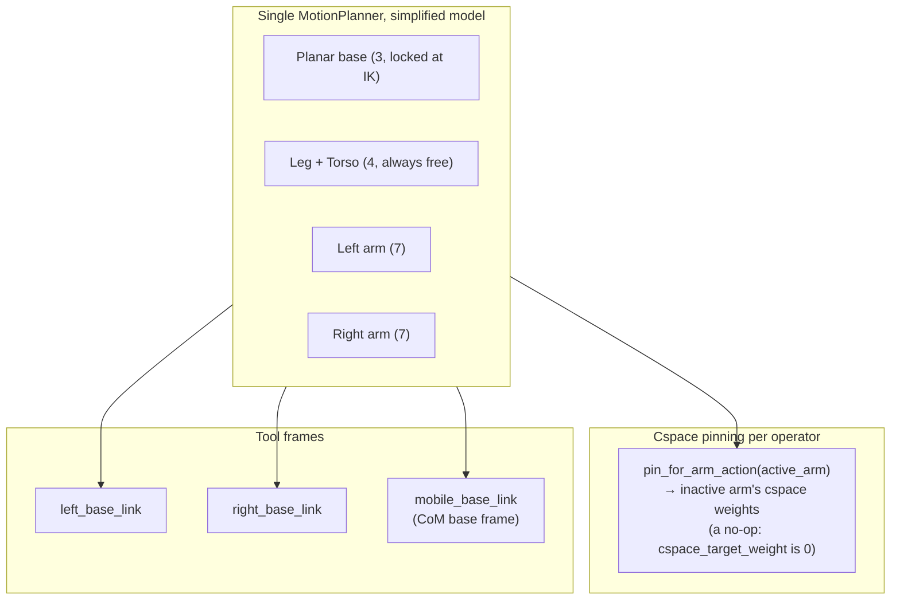

# cuTAMP with Booster T1

## Quick Links

The full README with installation instructions, examples, and detailed
documentation can be found in [README_DETAILED.md](README_DETAILED.md).

> **cuRobo fork dependency:** cuTAMP relies on local edits to the vendored
> `curobo/` tree (the `compute_com` plumbing; the CoM-aware seed-IK
> residual, whose solution is kept for each problem the seed IK solved, so
> the CoM-blind optimizer replaces only the failed ones; the URDF parser's
> link-CoM and link-mass fixes; a thread-safety fix for warp stream
> wrappers; and a seed-IK LM fix — 10 Python source files, no kernel
> changes; the earlier batched-COM kernel fix was dropped
> when the base moved to NVlabs PR #678, which fixes it upstream). The edits
> live on the `main` branch of the cuRobo fork (helpYoon/curobo) — a plain
> NVlabs checkout without them breaks cuTAMP, and its parser puts each
> link's CoM at R p + p instead of p (twice the offset for an unrotated
> inertial frame). Grep `cuTAMP` under
> `curobo/curobo/_src/` for the tagged ones (6 files tagged `cuTAMP fork`,
> plus `robot_state_transition[_cfg].py` tagged `cuTAMP local addition`);
> two are untagged: `solver/seed_ik/seed_iteration_state_manager.py` (it
> keeps the current objective when an LM step is rejected) and
> `robot/parser/parser_urdf.py` (a link's CoM is its inertial origin's
> translation, and a massless link weighs 0, not 0.01 kg).
> `git -C curobo diff ac5f931 main` (ac5f931 is the NVlabs base) lists them all.
> Without the `util/warp.py` fix, the background motion-planner build
> thread can crash the process with heap corruption
> (`malloc(): unaligned tcache chunk detected`).
>
> Set `SETUPTOOLS_SCM_PRETEND_VERSION=0.8.0` for every command: the fork's
> tags break setuptools_scm's version lookup, so without it `import curobo`
> fails with an `AssertionError`. Only `python -m …` and
> `pytest cutamp/tests/` run from the repo root get by without it (the
> `curobo/` checkout there shadows the package); `python examples/…`,
> `pytest examples/` and `cutamp-demo` fail even there.

## How it works (end-to-end)

cuTAMP solves a task-and-motion problem for the T1 by searching over **plan
skeletons** (symbolic action sequences) and, for each, optimizing a batch of
**particles** (candidate continuous parameters — grasps, placements, configs)
until one satisfies every hard constraint, then motion-planning the result.


1. **Task planning** — `task_plan_generator` (`cutamp/task_planning/`) enumerates
   PDDL-style plan skeletons over the T1 operators in `t1_domain.py`
   (`LeftPick`, `RightPlace`, `LeftRetractHolding`, …), breadth-first, trying
   the closer arm for each object first (`make_arm_affinity_priority_fn`).
2. **Particle initialization** — `ParticleInitializer`
   (`particle_initialization.py`) seeds a batch of candidate grasps / placements
   / configs (`samplers.py`) and runs cuRobo IK — with CoM-aware seed-IK — for
   each pick / place conf, re-solving particles whose CoM leaves the keyframe
   rectangle (`COM_HALF_EXTENTS`). Retract confs start at `t1_home`.
3. **Optimization** — `ParticleOptimizer` (`optimize_plan.py`) runs Adam over the
   particles against `CostFunction` (`cost_function.py`): hard constraints
   (kinematic, motion, collision, stable-placement, and the `ComPolygon`
   gate: every conf's CoM inside `COM_HALF_EXTENTS`, the real soles shrunk
   2 cm and another 5 mm for the arrival's deceleration) plus soft costs. Pose-class soft costs use **re-IK-coupled
   Adam** — outer Adam moves poses while dependent confs are re-projected every
   `reik_interval` steps by balance-first Gauss-Newton (`gn_refresh.py`: CoM
   in the support polygon first, then the pose, then joint-limit margins), with
   no cuRobo during Adam and the Adam step and refresh replayed as CUDA graphs
   (`cuda_graphs.py`); the final pre-check refresh repairs rows that miss
   tolerance or leave the CoM polygon with the full cuRobo IK
   (`--no_reik_balance_first`: pose-only GN with a low-seed cuRobo fallback).
   Adam stops after `early_stop_patience` steps without progress and keeps the
   best-seen particles. `ConstraintChecker` decides which particles satisfy.
4. **Motion planning** — `_motion_plan_with_retries` (`algorithm.py`) drives
   the best satisfying particles (up to `motion_plan_max_retries`, first
   success wins) through `motion_solver.py`: one `MotionPlanner` over the
   model's cspace, built on a background thread while the optimizer runs,
   re-pinned per operator (`pin_for_arm_action`, a no-op), and planned to each
   particle conf with `plan_cspace`. When `enable_com_polygon` is on (the
   default), each segment then passes `_balance_gate`: every frame's CoM and
   multibody ZMP (`com_zmp_in_support`) must stay inside the model's support
   rectangle (`world.model.support`): on the simplified model
   `SUPPORT_HALF_EXTENTS`, the real soles shrunk 2 cm; on the real legs the
   home stance's two soles, shrunk 2 cm and kept where each foot carries at
   least a tenth of the weight. A CoM outside fails the candidate and the next
   one is tried. On the simplified model a ZMP outside slows the segment down
   uniformly (`_retime`, up to `RETIME_MAX` = 4×), and a ZMP still outside at
   4× fails the candidate too. On the real legs every frame must also keep
   both soles on the stance (and the Trunk's tilt within the envelope's bound,
   where it sets one), and the gate sets every segment's pace (`_pace`): the
   smallest uniform time scale, faster or slower than the planner's and up to
   4×, at which every actuated joint's speed stays within cuRobo's limit,
   every joint's torque, cuRobo's RNEA with the floor's push on the soles
   (`SegmentTorques`), within its effort, and the ZMP inside. The frames it
   returns are checked again, and a segment no scale up to 4× passes fails the
   candidate, naming the check.
5. **Playback / save** — the Rerun visualizer renders every trajectory (both
   arms' held objects tracked); `--save_plan` pickles the processed plan
   (schema v3, `utils/plan_processor.py`) for the downstream MPC consumer
   ([`examples/load_motion_plan_for_mpc.py`](examples/load_motion_plan_for_mpc.py)
   shows how to read it). A segment the gate retimed (slowed down, or on the
   real legs sped up) also carries `planner_timing`, the same segment at the
   motion planner's own timing
   (`None` otherwise). A real-leg plan is saved raw (`stage3-raw`, in the
   model's joint order), which the MPC example refuses.

`run_cutamp` (`algorithm.py`) orchestrates these stages; `setup_cutamp` builds
the shared `TAMPWorld`.

## T1 Single-Planner Architecture (cuRobo v0.8)

cuTAMP plans for the T1 humanoid through a **single MotionPlanner** on one
of two planning models (`--robot`; `T1Model` in `robots/t1.py`). The default
is `real_legs` (below). `simplified`, the model the paper's ablation arms run
on (`--robot simplified`), is built from `t1_planar_base.yml`; its cspace is:

```
3 base (planar: base_j_x, base_j_y, base_j_yaw)   ← locked at IK time
2 leg  (ankle_pitch, knee_pitch)
2 torso (Torso_Pitch, Waist_Yaw)
7 left arm  (Left_Shoulder_Pitch ... Left_Hand_Roll)
7 right arm (Right_Shoulder_Pitch ... Right_Hand_Roll)
= 21 DOF
```

The mobile base is added as a virtual chain via `extra_links`
(`world → base_j_x → base_j_y → base_j_yaw → mobile_base_link`) and locked at
IK / motion-planner construction time, leaving an 18-DOF active cspace for arm
operators. Two tool frames (`left_base_link`, `right_base_link`) are exposed
on the same kinematics; per-arm IK builds one `GoalToolPose` over every tool
frame (`_build_multi_frame_goal`): the active frame gets the target, and the
others stay at their FK pose at the IK's start conf, which is what holds the
idle hand. `mobile_base_link` is a third tool frame, there only so the CoM
costs can read the base pose.



There is no per-arm "shared joint" propagation — the body joints are
genuinely shared in one cspace, so trajopt updates them coherently. The
inactive arm's tool moves through world during single-arm planning: the legs
and torso carry it, and `plan_cspace` holds nothing between the endpoint
confs (the pin is a no-op). The visualizer tracks both arms' held objects
through every trajectory (see `T1State.compute_all_held_obj_poses`).

`real_legs`, the default, is bfm_wm's T1 (`assets/t1_29dof/`) on a six-joint
floating base, built from `t1_29dof.yml`. Its 33 planned joints are the base (x, y, z, then
pitch, roll, yaw), both 7-joint arms, the Waist and the 12 leg joints; the
head and the gripper joints are locked. Both soles stand on the home stance:
the IK's sole goals, GN's sole rows and the kinematic constraint hold them
there, and the `stance` tool frame, at the home mid-sole on the floor, is the
support region's frame. The planner's dynamics include the floor's push on
the soles. The real legs run only the full system: they refuse the ablation
flags, which run with `--robot simplified`.

## Layout

### 📁 [`cutamp/robots/`](cutamp/robots/)

- **[`assets/t1_description/`](cutamp/robots/assets/t1_description/)**:
  - `t1_simplified.urdf` — URDF the planner loads (adds the `world` link the
    planar-base chain attaches to). Its masses are the real T1's, lumped for
    double support: the base carries both feet and ankle crosses, the shank
    both shanks, the thigh both legs' Hip_Pitch, Hip_Roll and Hip_Yaw links,
    and the arms and hands take
    `t1.urdf`'s. Its base origin is the sole plane, and its x, y CoM matches
    `t1.urdf`'s within 0.5 mm (grippers aside; `test_robot_com.py`).
    `t1.urdf` is the on-robot model the MPC
    uses, kept for reference (not loaded); its Trunk frame matches the
    planner's, so saved Trunk poses need no compensation.
  - `t1_planar_base.yml` — single cuRobo robot config: kinematics, cspace,
    `lock_joints` (head + grippers), `collision_link_names`, planar-base and
    attached-object `extra_links`, and the three tool frames.
  - `t1_spheres.yml` — collision spheres in each link's local frame; finger
    spheres are consolidated into `left_base_link` / `right_base_link` since
    the gripper joints are locked open.
  - `left_gripper_spheres.pt`, `right_gripper_spheres.pt` — pre-fit gripper
    spheres used by grasp sampling.
  - `meshes/` — STL meshes referenced by `t1_simplified.urdf`;
    `actual_meshes/` — the mesh set `t1.urdf` uses.
- **[`assets/t1_29dof/`](cutamp/robots/assets/t1_29dof/)** — the real-leg
  model: a pinned copy of bfm_wm's T1 (`PROVENANCE.yml` gives each file's
  source and sha1) and `build_planner_model.py`, which derives the planner's
  `t1_planner.urdf` (the vendor URDF plus a `world` link and cuTAMP's gripper),
  `t1_29dof.yml` and `t1_29dof_spheres.yml` from it; a rerun reproduces all
  three byte for byte.
- [`assets/README.md`](cutamp/robots/assets/README.md) — short index of the
  asset files.

- [`__init__.py`](cutamp/robots/__init__.py) — `RobotContainer` and its
  factory `load_t1_container()`. T1 exposes two tool frames; tool↔EE transforms
  account for T1's +X-toward-fingertips EE convention.

- [`t1.py`](cutamp/robots/t1.py) — T1 module:
  - `T1Model`, the planning model as data, and its two instances `SIMPLIFIED`
    and `REAL_LEGS` (`get_model(config.robot)`): the cspace and its joint
    groups, home, limit margins, support rectangle, sole frames and envelope.
  - cuRobo loaders: `get_t1_kinematics` (always `compute_com=True`;
    `compute_jacobian=True` for the GN refresh), `get_t1_ik_solver(scene)` (a single
    multi-tool-frame IK over both arms; with `enable_com_aware_ik=True`, the
    default, its seed-IK LM stage carries a CoM residual — a cuRobo fork
    edit — over the largest base-centred box inside `COM_HALF_EXTENTS`
    (the fork's box has no centre, so it falls 2 cm short at the toe),
    weighted by `T1_COM_IK_WEIGHT` and the
    pull-to-center `T1_COM_IK_CENTER_WEIGHT`; `num_seeds` / `lbfgs_iters` /
    `use_cuda_graph` configure the re-IK refresh solver), `get_t1_motion_planner`
    (the single planner with the base lock, the COM-over-polygon rollout
    soft cost, and the joint-limit-margin trajopt cost applied), and
    `get_t1_bodies` (a `T1Bodies` of every massive link, with cuRobo's
    masses and CoMs and the URDF's inertias, for the balance gate's
    multibody ZMP).
  - The simplified model's joint-name + index constants: `JOINT_NAMES_FULL`,
    `BASE_INDICES`, `BODY_INDICES`, `LEFT_ARM_JOINT_NAMES`,
    `RIGHT_ARM_JOINT_NAMES`, `t1_home`, the per-joint, per-side joint-limit bands
    `T1_LIMIT_MARGIN_LOWER` / `T1_LIMIT_MARGIN_UPPER`, and the planner's
    ankle-pitch upper band `T1_TRAJOPT_ANKLE_UPPER_MARGIN` (0.02 rad).
  - `T1RerunRobot` for visualization: sets the URDF's joints from a conf in
    the model's cspace (the base becomes a root transform) and the gripper
    state from `set_grippers`. Playback reprojects the planner's trajectories
    to the model's full cspace first.

### 📁 [`cutamp/`](cutamp/) — core

- [`tamp_world.py`](cutamp/tamp_world.py) — `TAMPWorld` wraps a
  TAMPEnvironment with the collision Scene, the single `Kinematics` (built
  with `compute_com=True`), a single multi-tool-frame `InverseKinematics`
  solver, and a `MotionPlanner` factory. `q_init` is the model's home. On the
  real legs it also holds the stance (`stance_soles`, `sole_goals`) and
  `segment_torques`. Built lazily: `ik_refresh_solver` (the low-seed,
  warm-started IK for re-IK refreshes when `reik_num_seeds > 0`),
  `kinematics_jac` (the Jacobian twin for the GN refresh), `bodies`
  (`get_t1_bodies`: a second `Kinematics` whose tool frames are every massive
  link, for the balance gate's multibody ZMP), and one `site_kinematics(name)`
  per Adam-loop FK site in `FK_SITES`.

- [`t1_state.py`](cutamp/t1_state.py) — `T1State` carries the planner, the
  per-tool-frame `tool_from_ee`, and per-arm `arm_holding` /
  `arm_grasp_transform`. Cspace pinning lives here:
  - `pin_for_arm_action(arm)` — write the inactive arm's cspace pin weights
    (a no-op: `cspace_target_weight` is 0).
  - `unpin()` — restore original weights.
  - `compute_held_obj_poses(arm, plan)` — per-timestep `world_from_obj` for a
    held object along a planner trajectory.
  - `compute_all_held_obj_poses(plan)` — `{arm: (obj_name, poses)}` for every
    arm currently holding (visualization needs both because the inactive
    arm's tool still translates with the body).

- [`_curobo_internals.py`](cutamp/_curobo_internals.py) — the cuRobo
  private-API helpers shared across modules, in one file (with `# TODO: file
  upstream issue` markers; one-off workarounds stay beside their callers:
  `motion_solver._attach_object` / `_detach_object`,
  `particle_initialization._achieved_pose_errors`): `get_attachment_manager`, `cspace_plan_succeeded`,
  `iter_rollouts`, the cspace target-weight `write…` / `snapshot…` /
  `restore…` trio (hosts-iterable), `build_pin_weights`, and
  `add_extra_cost` (custom-cost dispatch; effective for the planner's
  rollouts — for IK solve-time costs it is inert, which is why the CoM
  residual lives inside the seed-IK fork instead).

- [`com_polygon_cost.py`](cutamp/com_polygon_cost.py) — single source of
  truth for the balance geometry: the real soles (`SOLE_HALF_EXTENTS`,
  centred at `COM_CENTER`, 1 cm ahead of the ankle axis), the trajectory
  gate's `SUPPORT_HALF_EXTENTS` (the soles shrunk by `COM_SAFETY_MARGIN` =
  2 cm), the keyframes' `COM_HALF_EXTENTS` (a further `COM_DYNAMIC_RESERVE`
  = 5 mm in), `COM_INSIDE_MARGIN` / `COM_INSIDE_WEIGHT` and `COM_TOL`. Its
  consumers: `com_polygon_penalty` (outside-quadratic + inside-margin barrier),
  `ComOverBasePolygonCost` (the planner rollout cost),
  `compute_com_polygon_penalties` (the hard `ComPolygon` constraint),
  `compute_com_polygon_mask` (the post-IK COM-safe retry and the re-IK
  merge and repair checks), `compute_com_margin` (the static stability
  margin the ablation records), and for the trajectory gate
  `com_zmp_in_support` (each frame's CoM and multibody ZMP), `retime_factor`
  (the slowdown that brings the ZMP inside) and `compute_support_mask` (the
  audit's mask on `SUPPORT_HALF_EXTENTS`).

- [`joint_limit_cost.py`](cutamp/joint_limit_cost.py) — hinge² penalty on
  the `T1_LIMIT_MARGIN_*` bands, used twice: `joint_limit_margin_soft_cost`
  (the `joint_limit_margin` soft cost over segment-endpoint confs) and
  `JointLimitMarginCost` (the planner's trajopt cost, between endpoints,
  with `T1_TRAJOPT_ANKLE_UPPER_MARGIN` on the ankle-pitch upper side, which
  the endpoint bands leave at 0).

- [`motion_solver.py`](cutamp/motion_solver.py) — drives the plan skeleton
  through the single planner (`build_motion_planner`). Per-operator: pin the
  cspace, plan to the particle's conf with `plan_cspace`, then (when
  `enable_com_polygon` is on) pass `_balance_gate`: every frame's CoM and
  multibody ZMP must stay inside `SUPPORT_HALF_EXTENTS`; a ZMP excursion
  slows the segment uniformly (`_retime`, a C² cubic spline, up to
  `RETIME_MAX` = 4×), and a CoM excursion or a ZMP still out at 4× raises and
  fails the candidate. On the real legs (`_pace`) the gate times each segment
  at the smallest uniform scale its speed, torque and ZMP checks pass: the
  speed's and the torque's exactly, the ZMP's by a batched search to within
  `RETIME_TOL` = 2% above it, all on the planner's frames with the velocities
  over s and the accelerations over s². Each segment is appended to
  `accum_plans` (with `held_objs` for both arms; a retimed one also keeps
  `planner_timing`, the same spline at the planner's own timing), then the
  object is attached/detached via the AttachmentManager. Playback walks
  `accum_plans` and hands each entry to the visualizer. The run metrics get
  the gate's `retime_min`, `retime_max` (on the real legs the scales run below
  1 too), on the real legs `retime_binding` (segments per binding check:
  `velocity <joint>`, `torque <joint>`, `zmp`, or `none` for a still one),
  `traj_com_min_margin` and `traj_zmp_min_margin`, plus
  `plan_duration_s` and the measure-only audit `traj_com_violation_frac` /
  `traj_com_frames` against the gate's rectangle.

- [`particle_initialization.py`](cutamp/particle_initialization.py) — IK-seeded
  particle init for `LeftPick` / `RightPick` / `LeftPlace` / etc.
  `_ik_for_pose_com_safe` re-solves particles whose COM leaves the polygon
  (`_ik_for_pose_no_gate` when `enable_com_init_gate` is off).
  `_build_multi_frame_goal` builds the
  `GoalToolPose` covering every tool frame for single-arm actions: the
  active frame gets the target pose, while each inactive frame keeps its
  ENABLED pose criteria, targeting its FK pose at the IK's start conf: home
  in particle init, a perturbed home seed in the CoM-safe retries, or the
  current particle in a re-IK refresh.

- [`samplers.py`](cutamp/samplers.py) — grasp / placement / yaw samplers
  (`grasp_4dof_sampler`, `place_4dof_sampler`,
  `sample_yaw`) that seed the continuous particles.

- [`task_planning/`](cutamp/task_planning/) — the symbolic layer:
  `task_plan_generator` runs breadth-first search (`search.py`) over the domain
  structs (`tamp_structs.py`, `base_structs.py`, `constraints.py`, `costs.py`)
  to emit plan skeletons.

- [`t1_domain.py`](cutamp/t1_domain.py) — TAMP domain (fluents + operators)
  for T1: `LeftAt` / `RightAt`, `LeftHolding` / `RightHolding`,
  `LeftMoveFree` / `RightMoveFree`, `LeftMoveHolding` / `RightMoveHolding`,
  `LeftPick` / `RightPick`, `LeftPlace` /
  `RightPlace`, and `LeftRetractHolding` / `RightRetractHolding`,
  `LeftRetractFree` / `RightRetractFree`.

- [`config.py`](cutamp/config.py) — `TAMPConfiguration` (only T1 supported)
  and `SUPPORTED_SOFT_COSTS`. Notable defaults: `num_particles=256`;
  `coupled_reik=True` + `place_close_to_base` (validated together), with
  `soft_cost=["place_close_to_base", "joint_limit_margin"]`; balance-first GN
  refreshes (`reik_balance_first=True`, `reik_interval=5`; the config-only
  `reik_num_seeds=4` and `reik_lbfgs_iters=40` size the low-seed cuRobo
  refresh solver, used only when balance-first is off); `cuda_graphs=True`
  (`uses_cuda_graphs`: runs without coupled re-IK or balance-first, or with
  `align_yaw`, stay eager); `early_stop_patience=150`;
  `enable_com_polygon=True` (the planner's CoM cost, the `ComPolygon` hard
  constraint, and with `--motion_plan` the trajectory balance gate; the
  planner's joint-limit margin cost is always on),
  `enable_com_aware_ik=True` (seed-IK CoM residual, and the re-IK refresh's
  CoM terms). The
  ablation flags (`enable_com_hard_constraint`,
  `enable_com_init_gate`, `force_adam`, `soft_in_adam`) default to the full
  system.

- [`algorithm.py`](cutamp/algorithm.py) — `setup_cutamp` + `run_cutamp`
  outer loop. The motion-plan retry sweep lives in `_motion_plan_with_retries`:
  a cuRobo failure or a balance-gate rejection moves on to the next
  candidate, skipping candidates that repeat a failed plan.

- [`optimize_plan.py`](cutamp/optimize_plan.py) — Adam-based optimization over
  particles; respects `left_q0` / `right_q0` as fixed initial-state. Holds the
  re-IK dependencies (`IKDep`), the refreshes (GN with a merge gate, or
  balance-first), the best-seen snapshot and early stop (`_BestSnapshot`),
  per-refresh stats (`_ReikDriftGate`), and the CUDA step and refresh graphs
  (`G_step`, `G_refresh`; `--no_cuda_graphs` runs them eagerly).

- [`gn_refresh.py`](cutamp/gn_refresh.py) — batched damped Gauss-Newton
  projection of the warm conf onto a moved pose target: `gn_project_balanced`
  (default: CoM in the polygon first, then the pose, then joint-limit margins,
  with no cuRobo during Adam) and `gn_project` (`--no_reik_balance_first`:
  pose only; the caller keeps rows that meet checker tolerance and stay in the
  CoM polygon, and sends the rest to cuRobo).

- [`cuda_graphs.py`](cutamp/cuda_graphs.py) — `CapturedGraph` capture and
  replay of those graphs, refusing a replay once a device address it
  baked in has moved.

- [`cost_function.py`](cutamp/cost_function.py) — hard constraints
  (kinematic, motion, collision, stable placement, and the `ComPolygon`
  CoM-in-rectangle gate on `COM_HALF_EXTENTS` over every `q_*` conf) plus the soft costs listed in
  `SUPPORTED_SOFT_COSTS` (`place_close_to_base`, `joint_limit_margin`,
  `retract_close_to_home`, `minimize_body_movement`, the multi-object
  placement costs, …). `_compute_soft_cost` hard-codes the names, so a new
  soft cost goes in both places.

- [`costs.py`](cutamp/costs.py) — low-level differentiable cost primitives
  (`trajectory_length`, sphere-overlap, AABB, `curobo_pose_error`) that
  `cost_function.py` composes.

- [`constraint_checker.py`](cutamp/constraint_checker.py) — `ConstraintChecker`
  evaluates which particles satisfy every hard constraint (the satisfying set).

- [`cost_reduction.py`](cutamp/cost_reduction.py) — `CostReducer` reduces the
  cost dict to one weighted cost per particle (multipliers from
  `scripts/utils.py`), which ranks the candidates.

- [`experiment_logger.py`](cutamp/experiment_logger.py) — `ExperimentLogger`
  records per-run metrics and timings.

- [`rollout.py`](cutamp/rollout.py) — FK rollout helpers used by the cost
  graph (forward kinematics on the model's full cspace).

- [`conf_locking.py`](cutamp/conf_locking.py) — per-conf gradient masks
  (`build_grad_masks` / `apply_grad_masks`) that zero the base and
  inactive-arm DOFs so Adam can't move them.

- [`envs/`](cutamp/envs/) — `TAMPEnvironment`, `load_env`, and
  `raise_surface_height` (the `--surface_height` sweep);
  `assets/blocks_t1.yml` is the only env (two blocks and a goal pad on the
  ground).

- [`utils/visualizer.py`](cutamp/utils/visualizer.py) — Rerun visualizer.
  `log_joint_trajectory_with_mat4x4s(traj, mat4x4s, …)` accepts any number
  of held-object transforms per trajectory.

- [`utils/plan_processor.py`](cutamp/utils/plan_processor.py) —
  `process_motion_plan` turns the raw plan into the schema-v3 pickle
  `--save_plan` writes: world-frame Trunk and hand poses, joint
  velocities / accelerations, and Jacobian-based Cartesian velocities. A
  segment the balance gate slowed has more frames at the same `dt`, takes its
  joint derivatives from the gate's spline, and carries `planner_timing`: the
  same segment at the motion planner's own timing, in the same format (else
  `None`).

- Other [`utils/`](cutamp/utils/): `collision.py` (`WorldCollisionCost`,
  sphere-vs-scene distance), `common.py` (pose / transform helpers,
  `get_world_cfg`), `shapes.py` (`sample_greedy_surface_spheres`),
  `rerun_utils.py`, and `timer.py` (`TorchTimer`, GPU-synchronized timing).

### 📁 [`cutamp/tests/`](cutamp/tests/) — 335 tests in 42 files

Shared fixtures live in [`conftest.py`](cutamp/tests/conftest.py)
(`needs_cuda` marker, `make_blocks_t1_world` factory, the module-scoped
`blocks_t1_plan` world, GPU-memory cleanup, and the bitwise comparator
`assert_bitwise`). Highlights:

- [`test_t1_config.py`](cutamp/tests/test_t1_config.py) /
  [`test_t1_robot_module.py`](cutamp/tests/test_t1_robot_module.py) — YAML
  schema, cspace, lock-joints, tool frames, kinematics smoke.
- [`test_com_polygon_ik.py`](cutamp/tests/test_com_polygon_ik.py) — COM
  penalty math, mask/gate parity, and a guard on cuRobo's batched-COM kernel
  (fixed upstream in PR #678), on the default model.
- [`test_com_aware_seed_ik.py`](cutamp/tests/test_com_aware_seed_ik.py) —
  CoM-aware seed-IK: fork/cuTAMP penalty parity, FD-checked gradients,
  centering A/B with joint-limit and pose-accuracy guards, on the default
  model.
- [`test_motion_anchor.py`](cutamp/tests/test_motion_anchor.py) — full
  pipeline on the simplified model: cspace-anchored pick/place terminals, all arrivals
  CoM-in-rectangle, every exported frame's CoM and ZMP inside
  `SUPPORT_HALF_EXTENTS`, and slowed segments' `planner_timing`; the no-CoM
  arm is never gated.
- [`test_balance_gate.py`](cutamp/tests/test_balance_gate.py) — the
  simplified model's trajectory balance gate: the multibody ZMP against a float64 reference,
  CoM rejects, ZMP slowdowns up to the 4× cap, `_retime`'s endpoints, and
  the planner timing it keeps.
- [`test_robot_com.py`](cutamp/tests/test_robot_com.py) — `t1_simplified`'s
  real-T1 masses and CoM against yourdfpy and `t1.urdf`; the base is the sole
  plane.
- [`test_gn_refresh.py`](cutamp/tests/test_gn_refresh.py) /
  [`test_gn_balanced_step.py`](cutamp/tests/test_gn_balanced_step.py) — GN
  refresh, including the Jacobian-convention guard, and the balance-first core
  (`test_gn_refresh.py` on the default model, except the pose-only
  `gn_project` and the margin bands, on the simplified one).
- [`test_step_lockstep.py`](cutamp/tests/test_step_lockstep.py) and the
  `test_cuda_graphs*.py` files — every Adam step bitwise against its twin and
  the reference math; every graph replay bitwise against eager. The full
  system runs on the default model; the ablation arms, and the byte-exact
  memory reading across two optimize calls, on the simplified one.
- [`test_t1_real_legs_model.py`](cutamp/tests/test_t1_real_legs_model.py),
  [`test_t1_29dof_assets.py`](cutamp/tests/test_t1_29dof_assets.py), the
  `test_real_legs_*.py` files and
  [`test_floor_wrench.py`](cutamp/tests/test_floor_wrench.py) — the real-leg
  model: the pinned assets and their byte-identical rebuild, the stance and
  its support, IK and GN holding the soles, the gate's sole, tilt, torque and
  speed checks and the pace they set, the floor's push, and `--robot
  real_legs` end to end.
- Plus pin lifecycle, arm-affinity priority, plan-processor derivatives,
  joint-limit margins (the simplified model's bands), motion attach / retry,
  the ablation runner and analyzer, and a coupled-reIK smoke test (its
  pose-only arm on the simplified model).

Run with:
`PYTEST_DISABLE_PLUGIN_AUTOLOAD=1 pytest cutamp/tests/ -q`
(GPU required for the integration tests; ~6 min on an RTX 4090: 344
passed, 8 skipped on 2026-11-05).
`CUTAMP_SLOW=1` also runs the 8 slow live tests: 6 `--cuda_graphs` runs in
[`test_cuda_graphs_live.py`](cutamp/tests/test_cuda_graphs_live.py), the floor
hook on a live motion planner in
[`test_floor_wrench.py`](cutamp/tests/test_floor_wrench.py) and the
`--robot real_legs` run in
[`test_real_legs_motion.py`](cutamp/tests/test_real_legs_motion.py). The MPC
example has its own: `pytest examples/`.

### 📁 [`cutamp/scripts/`](cutamp/scripts/)

- [`run_cutamp.py`](cutamp/scripts/run_cutamp.py) — main entry point
  (installed as `cutamp-demo`). T1 / `blocks_t1` only (no `--env` flag, no
  other envs in this branch); `--robot` picks the planning model
  (`real_legs`, the default, or `simplified`), `--surface_height` raises the
  blocks and goal pad, `--seed` seeds the sampling, and `--save_plan PATH` (or
  `auto`, next to the run's metrics) saves the plan: processed into schema v3
  on the simplified model, raw (`stage3-raw`, the model's joints) on the real
  legs.
- [`run_ablation.py`](cutamp/scripts/run_ablation.py) — the 2x2 CoM × re-IK
  ablation plus `default_reik` (cells `full`, `default_reik`, `no_com`,
  `no_reik`, `standard` × 4 heights × 10 seeds, 200 runs at `-n 512`, all on
  the simplified model), one
  `run_cutamp` subprocess per run that saves its plan (`--save_plan auto`),
  with a resumable manifest; `--smoke` / `--heights` / `--seeds` shrink it.
  `--gate` runs the speed gate instead: both models at `-n` 64,
  interleaved, over the same heights and seeds, each run replayable from its
  seed.
- [`analyze_ablation.py`](cutamp/scripts/analyze_ablation.py) — turns that
  manifest into `results.csv`, `deltas.csv`, `results.md` and figures; with
  `--gate`, a gate study into `gate.json` and `gate.md`: per model and `-n`
  the runs, planning-time median and p90 and the stage times, and the verdict
  at `-n` 64 (all 40 runs of each model timed, every real-leg run solved,
  motion-planned and balanced, and median and p90 times at most 1.5× and 2×
  the simplified model's).
- [`real_legs_report.py`](cutamp/scripts/real_legs_report.py) — the real-leg
  plans of a study: per joint, the peak torque against its effort and the peak
  speed against the motor's knee speed and cuRobo's limit; per run, the
  largest Trunk tilt and sole drift, the segments the gate slowed and sped
  up, its margins, time scales and binding checks, and any planner-timed
  segment past an effort (`PREFIX.json`, `PREFIX.md`).
- [`check_plan_margins.py`](cutamp/scripts/check_plan_margins.py) — per-joint
  distances to limits in a saved plan; exits 1 if a protected side comes
  within `--threshold` (0.05 rad) or any waypoint violates a limit.
- [`utils.py`](cutamp/scripts/utils.py) — the default cost multipliers and
  constraint tolerances, and `setup_logging`.
- [`gripper_sphere_editor.py`](cutamp/scripts/gripper_sphere_editor.py) —
  interactive gripper-sphere editor.
- [`robot_sphere_editor.py`](cutamp/scripts/robot_sphere_editor.py) —
  interactive robot-sphere editor. Both editors build on
  [`_sphere_editor_common.py`](cutamp/scripts/_sphere_editor_common.py) and
  need `open3d` (the `editor` extra).

## Usage

By default a run plans on the real legs (bfm_wm's T1 on its home stance)
with 256 particles and the validated pair —
`place_close_to_base` optimized under re-IK-coupled Adam — plus the
balance-first GN refresh replayed as CUDA graphs, the `joint_limit_margin`
and `minimize_body_movement` soft costs and CoM-aware IK,
so placements stay near the
base, endpoint confs keep off their joint limits, and every arrival lands with
its CoM inside the keyframe rectangle. With `--motion_plan`, every trajectory
frame also keeps its CoM and ZMP inside the soles shrunk 2 cm: the gate sets
each segment's pace (on the simplified model a segment whose ZMP would leave
them is slowed down), up to 4×, and a candidate that still fails is dropped
(`motion_solver._balance_gate`). `--robot simplified` plans on the 21-DOF
model, which the ablation flags, schema v3 and `check_plan_margins` need.

```bash
# Smoke test (no motion plan)
python -m cutamp.scripts.run_cutamp -n 16 --num_opt_steps 50

# Full run with motion planning, no visualizer
python -m cutamp.scripts.run_cutamp --motion_plan -n 64 --disable_visualizer

# With Rerun visualizer
python -m cutamp.scripts.run_cutamp --motion_plan -n 64

# Save the processed plan (schema v3; a segment the balance gate slowed also
# carries planner_timing, the planner's own faster timing) for the MPC
# consumer, then read it back and check its joint-limit margins (margins need
# balance-first: with --no_reik_balance_first the check failed on all 10 runs
# at -n 64, seeds 0-9, --soft_cost joint_limit_margin, each on Torso_Pitch's
# lower side, measured 2026-11-02, before the real-mass model and the
# trajectory gate); schema v3 and the check are the simplified model's
python -m cutamp.scripts.run_cutamp --robot simplified --motion_plan -n 64 \
    --save_plan data/motion_plan.pkl
python examples/load_motion_plan_for_mpc.py data/motion_plan.pkl
python -m cutamp.scripts.check_plan_margins --plan data/motion_plan.pkl

# Different soft costs (replaces the default list)
python -m cutamp.scripts.run_cutamp --motion_plan \
    --soft_cost retract_close_to_home minimize_body_movement

# Classic single-level optimization (no re-IK, so the soft costs stay out of
# Adam and the run is eager), an ablation arm, so on the simplified model
python -m cutamp.scripts.run_cutamp --robot simplified --motion_plan --no_coupled_reik

# Eager Adam steps and refreshes (no CUDA graphs)
python -m cutamp.scripts.run_cutamp --motion_plan --no_cuda_graphs

# 2x2 ablation study plus default_reik (200 runs at -n 512 on the simplified
# model, each saving its plan), then its table and figures
python -m cutamp.scripts.run_ablation --out /tmp/ablation-study
python -m cutamp.scripts.analyze_ablation \
    --manifest /tmp/ablation-study/manifest.json --out docs/ablation

# The real legs (the default, named here), saving the raw plan
python -m cutamp.scripts.run_cutamp --robot real_legs --motion_plan --save_plan auto

# The speed gate (both models, 80 runs), its verdict, and the real-leg report
python -m cutamp.scripts.run_ablation --out /tmp/gate-study --gate
python -m cutamp.scripts.analyze_ablation --gate \
    --manifest /tmp/gate-study/manifest.json --out /tmp/gate-study/gate
python -m cutamp.scripts.real_legs_report --study /tmp/gate-study \
    --out /tmp/gate-study/real_legs
```

**Available soft costs** (see `SUPPORTED_SOFT_COSTS`; T1-only ones marked):
- `place_close_to_base` *(default)* — pull placed objects toward the base;
  keeps placements inside the reach range where the CoM-aware IK can center
  the COM.
- `joint_limit_margin` *(default, T1)* — keep segment-endpoint confs out of a
  0.1 rad band inside each joint limit (no band on the home-side bounds the
  standing pose sits on). Under coupled re-IK it moves only the retract confs:
  pick/place confs are outside Adam, so the balance-first refresh's margin
  level keeps them out of the same bands, listed or not
  (`--no_reik_balance_first` leaves them unguarded).
- `retract_close_to_home` *(T1)* — penalize retract configs far from `t1_home`.
- `minimize_body_movement` *(T1; default on the real legs)* — penalize body
  (leg/torso/waist) drift.
- `dist_from_origin`, `max_obj_dist` / `min_obj_dist`, `min_y` / `max_y`,
  `align_yaw` — multi-object placement costs.

Pose-class soft costs (e.g. `place_close_to_base`) require the re-IK-coupled
optimizer (`coupled_reik`, on by default): outer Adam moves pose/grasp
particles while their dependent confs are re-projected every `reik_interval`
steps (balance-first Gauss-Newton, no cuRobo during Adam; the final pre-check
refresh still repairs with cuRobo IK; `--no_reik_balance_first` restores the
pose-only Gauss-Newton with a cuRobo IK fallback).

Peak VRAM on the simplified model with motion planning: about 3 GiB at `-n 64`
and 8 GiB at the default 256 (the CUDA graphs add about 0.05 and 0.3 GiB);
`--no_reik_balance_first` takes about 3.5 and 9.5 GiB (see
`num_particles` in `config.py` for 512 and 1024). These figures and the
commands above use PyTorch's default allocator. They were measured on
2026-10-31, before the real-mass model and the trajectory balance gate
(which adds one lazily built `Kinematics` and an FK pass per segment after
Adam).

## Key Design Decisions

1. **Single MotionPlanner** — cuRobo v0.8's `GoalToolPose` takes a
   target for every tool frame of a kinematics that exposes both arms (the
   inactive frames get their current FK pose), and the planner then plans
   every segment in cspace, so we no longer need
   two MotionGens or per-arm "shared joint" propagation.

2. **Planar base via `extra_links`** — `world → base_j_x → base_j_y →
   base_j_yaw → mobile_base_link` adds 3 virtual DOFs that get hard-locked at
   IK / motion-planner construction time for arm operators (so the base
   doesn't drift while reaching).

3. **Inactive-arm handling** — `pin_for_arm_action` writes the inactive
   arm's per-DOF `cspace_target_dof_weight` into the optimizer rollouts of
   the planner's trajopt solver and of its internal IK solver (restored by
   `unpin()`), and particle-init and refresh IK write the same weights for
   each call. The pin is a no-op: cuRobo scales those weights by
   `cspace_target_weight`, which is 0 in every IK and trajopt config used,
   and cuRobo zeroes it again when it builds the cost. The term's target is
   also a zero joint vector, not the arm's current joints. What holds the
   inactive hand is IK's multi-frame goal, which targets that frame where it
   is, at the confs IK solves. The optimizer's gradient masks and the GN
   refresh keep the inactive arm's joints fixed, so that hand rides with the
   trunk when they move the body, and `plan_cspace` holds nothing between
   confs. Both arms are in the optimizer's collision constraints and the
   planner's collision checks, with three gaps: GN checks no collision (the
   optimizer rescores every conf each step), a pick or place segment
   disables its block or support surface for the whole robot, and a segment
   the balance gate retimes (slows down, or on the real legs speeds up) is
   resampled through the planner's frames (`_retime`) without new collision
   or joint-limit checks on the in-between frames.

4. **Both arms tracked through every trajectory** — body joints are unlocked
   during single-arm planning, so an inactive arm holding a block will still
   translate that block through world. `compute_all_held_obj_poses` returns
   poses for every holding arm so the visualizer renders both correctly.

5. **Retract after pick/place** — the per-arm `RetractHolding` (collision checks
   exclude held object) and `RetractFree` (empty gripper) operators move toward
   `t1_home` after each manipulation. Retract confs start at `t1_home`; the
   hard collision, joint-limit and `ComPolygon` constraints, the default
   `joint_limit_margin` soft cost (under coupled re-IK) and the opt-in
   `retract_close_to_home` shape the result.

6. **cuRobo internals isolated** — every workaround that reaches into cuRobo's
   private API lives in
   [`cutamp/_curobo_internals.py`](cutamp/_curobo_internals.py) so a
   future cuRobo upgrade has one place to audit. The exceptions are the
   one-off workarounds beside their callers (`_attach_object` /
   `_detach_object`, `_achieved_pose_errors`), plain `curobo._src` imports
   (the cost base classes and `SelfCollisionCost`, `utils/collision.py`'s
   scene collision, `config_io`) and the fork edits inside the vendored
   `curobo/` tree itself (grep `cuTAMP`, plus two untagged ones: the seed-IK
   fix in `seed_iteration_state_manager.py` and the link-CoM and link-mass
   fixes in `parser_urdf.py`; `git -C curobo diff ac5f931 main` lists them
   all); those must travel with any cuRobo upgrade, or the link CoMs come
   back wrong.

7. **Layered COM safety** — the COM is kept inside the real T1's soles,
   shrunk 2 cm (`SUPPORT_HALF_EXTENTS`, every trajectory frame) and another
   5 mm for keyframes (`COM_HALF_EXTENTS`), both centred on `COM_CENTER`,
   1 cm ahead of the ankle axis (`com_polygon_cost.py`), by independent
   layers, each guarding a different frontier:
   - **CoM-aware seed-IK** (cuRobo fork residual, on by default): the IK
     itself trades hand pose vs COM, recruiting the knees/ankles within
     joint limits, with a pull-to-center term on a base-centred box
     (`get_t1_ik_solver`, 2 cm short of the keyframe rectangle at the toe) —
     endpoint confs come out near the ankle axis, not edge-parked.
   - **Hard `ComPolygon` gate**: every optimizer conf must have COM penalty
     ≤ `COM_TOL`; a post-IK mask + retry backstops the IK.
   - **Balance-first re-IK refresh**: covered confs are outside Adam, so the
     GN refresh puts the CoM first (the pose is least squares inside the
     polygon) and the final pre-check refresh repairs any row still outside
     with the CoM-aware cuRobo IK (`--no_reik_balance_first` instead falls
     back to the low-seed CoM-aware cuRobo IK for each GN row that misses
     pose tolerance or leaves the polygon).
   - **COM-anchored terminals**: pick/place trajectories end exactly at the
     gate-approved conf (`plan_cspace`), so cuRobo can't re-resolve the
     redundancy at the endpoint.
   - **Planner rollout COM cost**: a soft barrier (`ComOverBasePolygonCost`)
     pushes mid-trajectory frames toward the keyframe rectangle between
     anchored endpoints; it cannot guarantee them.
   - **Trajectory balance gate** (`motion_solver._balance_gate`,
     `--motion_plan` only): every frame's CoM and multibody ZMP
     (`com_zmp_in_support`, from the plan's own velocities and
     accelerations) must stay inside `SUPPORT_HALF_EXTENTS`. A CoM exit fails
     the candidate; a ZMP exit slows the segment uniformly (`_retime`, up to
     `RETIME_MAX` = 4×) instead of letting it tip, and fails it past 4×.
   - **`place_close_to_base`** (default soft cost): biases chosen placements
     away from the far-reach regime where no in-limit posture can center
     the COM.

   `--no_com_all` (the ablation umbrella) turns off the seed-IK residual
   and the refresh's CoM terms, the gate and its init retry, the planner
   cost and the trajectory balance gate together. `place_close_to_base`
   stays when it is in `--soft_cost`, and the measure-only metrics
   (`traj_com_violation_frac`, `best_com_margin`, `com_in_polygon_per_conf`)
   are still recorded.
