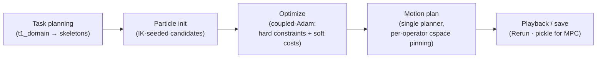
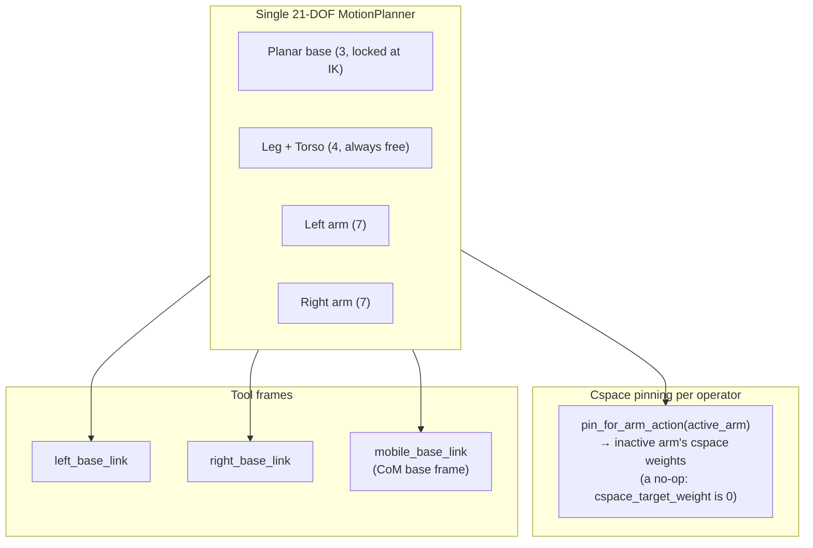

# cuTAMP with Booster T1

## Quick Links

The full README with installation instructions, examples, and detailed
documentation can be found in [README_DETAILED.md](README_DETAILED.md).

> **cuRobo fork dependency:** cuTAMP relies on local edits to the vendored
> `curobo/` tree (the `compute_com` plumbing, the CoM-aware seed-IK
> residual, a thread-safety fix for warp stream wrappers, and a seed-IK LM
> fix — 9 Python source files, no kernel changes; the earlier batched-COM kernel
> fix was dropped
> when the base moved to NVlabs PR #678, which fixes it upstream). The edits
> live on the `main` branch of the cuRobo fork (helpYoon/curobo) — a plain
> NVlabs checkout without them breaks cuTAMP. Grep `cuTAMP` under
> `curobo/curobo/_src/` for the tagged ones (6 files tagged `cuTAMP fork`,
> plus `robot_state_transition[_cfg].py` tagged `cuTAMP local addition`);
> the ninth, `solver/seed_ik/seed_iteration_state_manager.py`, is untagged
> (it keeps the current objective when an LM step is rejected).
> Without the `util/warp.py` fix, the background motion-planner build
> thread can crash the process with heap corruption
> (`malloc(): unaligned tcache chunk detected`).

## How it works (end-to-end)

cuTAMP solves a task-and-motion problem for the T1 by searching over **plan
skeletons** (symbolic action sequences) and, for each, optimizing a batch of
**particles** (candidate continuous parameters — grasps, placements, configs)
until one satisfies every hard constraint, then motion-planning the result.



1. **Task planning** — `task_plan_generator` (`cutamp/task_planning/`) enumerates
   PDDL-style plan skeletons over the T1 operators in `t1_domain.py`
   (`LeftPick`, `RightPlace`, `LeftRetractHolding`, …), breadth-first, trying
   the closer arm for each object first (`make_arm_affinity_priority_fn`).
2. **Particle initialization** — `ParticleInitializer`
   (`particle_initialization.py`) seeds a batch of candidate grasps / placements
   / configs (`samplers.py`) and runs cuRobo IK — with CoM-aware seed-IK — for
   each pick / place conf, re-solving particles whose COM leaves the support
   polygon. Retract confs start at `t1_home`.
3. **Optimization** — `ParticleOptimizer` (`optimize_plan.py`) runs Adam over the
   particles against `CostFunction` (`cost_function.py`): hard constraints
   (kinematic, motion, collision, stable-placement, the `ComPolygon`
   COM-in-hull gate) plus soft costs. Pose-class soft costs use **re-IK-coupled
   Adam** — outer Adam moves poses while dependent confs are re-projected every
   `reik_interval` steps by balance-first Gauss-Newton (`gn_refresh.py`: CoM
   in the support polygon first, then the pose, then joint-limit margins), with
   no cuRobo during Adam and the Adam step and refresh replayed as CUDA graphs
   (`cuda_graphs.py`); the final pre-check refresh repairs rows that miss
   tolerance or leave the CoM polygon with the full cuRobo IK
   (`--no_reik_balance_first`: pose-only GN with a low-seed cuRobo fallback).
   Adam stops after `early_stop_patience` steps without progress and keeps the
   best-seen particles. `ConstraintChecker` decides which particles satisfy.
4. **Motion planning** — `_motion_plan_with_retries` (`algorithm.py`) drives the
   best satisfying particles (up to `motion_plan_max_retries`, first success
   wins) through `motion_solver.py`: one 21-DOF `MotionPlanner`, built on a
   background thread while the optimizer runs, re-pinned per operator
   (`pin_for_arm_action`), and planned to each particle conf with `plan_cspace`.
5. **Playback / save** — the Rerun visualizer renders every trajectory (both
   arms' held objects tracked); `--save_plan` pickles the processed plan
   (schema v3, `utils/plan_processor.py`) for the downstream MPC consumer
   ([`examples/load_motion_plan_for_mpc.py`](examples/load_motion_plan_for_mpc.py)
   shows how to read it).

`run_cutamp` (`algorithm.py`) orchestrates these stages; `setup_cutamp` builds
the shared `TAMPWorld`.

## T1 Single-Planner Architecture (cuRobo v0.8)

cuTAMP plans for the T1 humanoid through a **single 21-DOF
MotionPlanner** built from `t1_planar_base.yml`. The cspace is:

```
3 base (planar: base_j_x, base_j_y, base_j_yaw)   ← locked at IK time
2 leg  (ankle_pitch, knee_pitch)
2 torso (Torso_Pitch, Waist_Yaw)
7 left arm  (Left_Shoulder_Pitch ... Left_Hand_Roll)
7 right arm (Right_Shoulder_Pitch ... Right_Hand_Roll)
= 21 DOF
```

The mobile base is added as a virtual chain via `extra_links`
(`world → base_j_x → base_j_y → base_j_yaw → mobile_base_link`) and locked at
IK / motion-planner construction time, leaving an 18-DOF active cspace for arm
operators. Two tool frames (`left_base_link`, `right_base_link`) are exposed
on the same kinematics; per-arm IK uses `GoalToolPose` to target one frame at
a time. `mobile_base_link` is a third tool frame, there only so the CoM costs
can read the base pose.



There is no per-arm "shared joint" propagation — the body joints are
genuinely shared in one cspace, so trajopt updates them coherently. The
inactive arm's tool moves through world during single-arm planning because
the body translates; the visualizer tracks both arms' held objects through
every trajectory (see `T1State.compute_all_held_obj_poses`).

## Layout

### 📁 [`cutamp/robots/`](cutamp/robots/)

- **[`assets/t1_description/`](cutamp/robots/assets/t1_description/)**:
  - `t1_simplified.urdf` — URDF the planner loads (adds the `world` link the
    planar-base chain attaches to). `t1.urdf` is the on-robot model the MPC
    uses, kept for reference (not loaded); its Trunk frame matches the
    planner's, so saved Trunk poses need no compensation.
  - `t1_planar_base.yml` — single cuRobo robot config: kinematics, cspace,
    `lock_joints` (head + grippers), `collision_link_names`, planar-base and
    attached-object `extra_links`, and the three tool frames.
  - `t1_spheres.yml` — collision spheres in each link's local frame; finger
    spheres are consolidated into `left_base_link` / `right_base_link` since
    the gripper joints are locked open.
  - `left_gripper_spheres.pt`, `right_gripper_spheres.pt` — pre-fit gripper
    spheres used by grasp sampling.
  - `meshes/` — STL meshes referenced by `t1_simplified.urdf`;
    `actual_meshes/` — the mesh set `t1.urdf` uses.
- [`assets/README.md`](cutamp/robots/assets/README.md) — short index of the
  asset files.

- [`__init__.py`](cutamp/robots/__init__.py) — `RobotContainer` and its
  factory `load_t1_container()`. T1 exposes two tool frames; tool↔EE transforms
  account for T1's +X-toward-fingertips EE convention.

- [`t1.py`](cutamp/robots/t1.py) — T1 module:
  - cuRobo loaders: `get_t1_kinematics` (always `compute_com=True`;
    `compute_jacobian=True` for the GN refresh), `get_t1_ik_solver(scene)` (a single
    multi-tool-frame IK over both arms; with `enable_com_aware_ik=True`, the
    default, its seed-IK LM stage carries a CoM-over-support-rectangle
    residual — a cuRobo fork edit — weighted by `T1_COM_IK_WEIGHT` and the
    pull-to-center `T1_COM_IK_CENTER_WEIGHT`; `num_seeds` / `lbfgs_iters` /
    `use_cuda_graph` configure the re-IK refresh solver), and `get_t1_motion_planner`
    (the single planner with the base lock, the COM-over-polygon rollout
    soft cost, and the joint-limit-margin trajopt cost applied).
  - Joint-name + index constants: `JOINT_NAMES_FULL`, `BASE_INDICES`,
    `BODY_INDICES`, `LEFT_ARM_JOINT_NAMES`, `RIGHT_ARM_JOINT_NAMES`,
    `t1_home`, and the per-joint, per-side joint-limit bands
    `T1_LIMIT_MARGIN_LOWER` / `T1_LIMIT_MARGIN_UPPER`.
  - `T1RerunRobot` for visualization: maps a 21-DOF cspace vector into the
    URDF's 28 joints (the planar base becomes a root transform), splices in
    head + per-arm gripper state. Playback reprojects the planner's 18-DOF
    trajectories to 21 first.

### 📁 [`cutamp/`](cutamp/) — core

- [`tamp_world.py`](cutamp/tamp_world.py) — `TAMPWorld` wraps a TAMPEnvironment
  with the collision Scene, the single `Kinematics` (built with
  `compute_com=True`), a single multi-tool-frame
  `InverseKinematics` solver, and a `MotionPlanner` factory. `q_init` is one
  21-DOF tensor. Built lazily: `ik_refresh_solver` (the low-seed, warm-started
  IK for re-IK refreshes when `reik_num_seeds > 0`), `kinematics_jac` (the
  Jacobian twin for the GN refresh), and one `site_kinematics(name)` per
  Adam-loop FK site in `FK_SITES`.

- [`t1_state.py`](cutamp/t1_state.py) — `T1State` carries the planner,
  kinematics, current joint state, and per-arm `arm_holding` /
  `arm_grasp_transform`. Cspace pinning lives here:
  - `pin_for_arm_action(arm)` — write the inactive arm's cspace pin weights
    (a no-op: `cspace_target_weight` is 0).
  - `unpin()` — restore original weights.
  - `compute_held_obj_poses(arm, plan)` — per-timestep `world_from_obj` for a
    held object along a planner trajectory.
  - `compute_all_held_obj_poses(plan)` — `{arm: (obj_name, poses)}` for every
    arm currently holding (visualization needs both because the inactive
    arm's tool still translates with the body).

- [`_curobo_internals.py`](cutamp/_curobo_internals.py) — every cuRobo
  private-API workaround in one file (with `# TODO: file upstream issue`
  markers): `get_attachment_manager`, `cspace_plan_succeeded`,
  `iter_rollouts`, the cspace target-weight `write…` / `snapshot…` /
  `restore…` trio (hosts-iterable), `build_pin_weights`, and
  `add_extra_cost` (custom-cost dispatch; effective for the planner's
  rollouts — for IK solve-time costs it is inert, which is why the CoM
  residual lives inside the seed-IK fork instead).

- [`com_polygon_cost.py`](cutamp/com_polygon_cost.py) — single source of
  truth for the COM-over-support-rectangle geometry (`COM_HALF_EXTENTS`,
  `COM_INSIDE_MARGIN` / `COM_INSIDE_WEIGHT`, `COM_TOL`) and its consumers:
  `com_polygon_penalty` (outside-quadratic + inside-margin barrier),
  `ComOverBasePolygonCost` (the planner rollout cost),
  `compute_com_polygon_mask` / `compute_com_polygon_penalties` (the
  hard `ComPolygon` gate + post-IK COM-safe retry), and `compute_com_margin`
  (the static stability margin the ablation records).

- [`joint_limit_cost.py`](cutamp/joint_limit_cost.py) — hinge² penalty on
  the `T1_LIMIT_MARGIN_*` bands, used twice: `joint_limit_margin_soft_cost`
  (the `joint_limit_margin` soft cost over segment-endpoint confs) and
  `JointLimitMarginCost` (the planner's trajopt cost, between endpoints).

- [`motion_solver.py`](cutamp/motion_solver.py) — drives the plan skeleton
  through the single planner (`build_motion_planner`). Per-operator: pin the
  cspace, plan to the particle's conf with `plan_cspace`, append a
  trajectory entry to `accum_plans` (with `held_objs` for both arms), then
  attach/detach via the AttachmentManager. Playback walks `accum_plans` and
  hands each entry to the visualizer; a measure-only audit of every frame's
  COM (`traj_com_violation_frac`) goes into the run metrics.

- [`particle_initialization.py`](cutamp/particle_initialization.py) — IK-seeded
  particle init for `LeftPick` / `RightPick` / `LeftPlace` / etc.
  `_ik_for_pose_com_safe` re-solves particles whose COM leaves the polygon
  (`_ik_for_pose_no_gate` when `enable_com_init_gate` is off).
  `_build_multi_frame_goal` builds the
  `GoalToolPose` covering every tool frame for single-arm actions: the
  active frame gets the target pose, while inactive frames keep their
  ENABLED pose criteria targeting their FK poses at the segment's start
  state.

- [`samplers.py`](cutamp/samplers.py) — grasp / placement / yaw samplers
  (`grasp_4dof_sampler`, `place_4dof_sampler`,
  `sample_yaw`) that seed the continuous particles.

- [`task_planning/`](cutamp/task_planning/) — the symbolic layer:
  `task_plan_generator` runs breadth-first search (`search.py`) over the domain
  structs (`tamp_structs.py`, `base_structs.py`, `constraints.py`, `costs.py`)
  to emit plan skeletons.

- [`t1_domain.py`](cutamp/t1_domain.py) — TAMP domain (fluents + operators)
  for T1: `LeftAt` / `RightAt`, `LeftHolding` / `RightHolding`,
  `LeftMoveFree` / `RightMoveFree`, `LeftMoveHolding` / `RightMoveHolding`,
  `LeftPick` / `RightPick`, `LeftPlace` /
  `RightPlace`, and `LeftRetractHolding` / `RightRetractHolding`,
  `LeftRetractFree` / `RightRetractFree`.

- [`config.py`](cutamp/config.py) — `TAMPConfiguration` (only T1 supported)
  and `SUPPORTED_SOFT_COSTS`. Notable defaults: `num_particles=256`;
  `coupled_reik=True` + `place_close_to_base` (validated together), with
  `soft_cost=["place_close_to_base", "joint_limit_margin"]`; balance-first GN
  refreshes (`reik_balance_first=True`, `reik_interval=5`; the config-only
  `reik_num_seeds=4` and `reik_lbfgs_iters=40` size the low-seed cuRobo
  refresh solver, used only when balance-first is off); `cuda_graphs=True`
  (`uses_cuda_graphs`: runs without coupled re-IK or balance-first, or with
  `align_yaw`, stay eager); `early_stop_patience=150`;
  `enable_com_polygon=True` (planner cost; the planner's joint-limit margin
  cost is always on), `enable_com_aware_ik=True` (seed-IK CoM residual). The
  ablation flags (`enable_com_hard_constraint`,
  `enable_com_init_gate`, `force_adam`, `soft_in_adam`) default to the full
  system.

- [`algorithm.py`](cutamp/algorithm.py) — `setup_cutamp` + `run_cutamp`
  outer loop. The motion-plan retry sweep lives in `_motion_plan_with_retries`
  (it skips candidates that repeat a failed plan).

- [`optimize_plan.py`](cutamp/optimize_plan.py) — Adam-based optimization over
  particles; respects `left_q0` / `right_q0` as fixed initial-state. Holds the
  re-IK dependencies (`IKDep`), the refreshes (GN with a merge gate, or
  balance-first), the best-seen snapshot and early stop (`_BestSnapshot`),
  per-refresh stats (`_ReikDriftGate`), and the CUDA step and refresh graphs
  (`G_step`, `G_refresh`; `--no_cuda_graphs` runs them eagerly).

- [`gn_refresh.py`](cutamp/gn_refresh.py) — batched damped Gauss-Newton
  projection of the warm conf onto a moved pose target: `gn_project_balanced`
  (default: CoM in the polygon first, then the pose, then joint-limit margins,
  with no cuRobo during Adam) and `gn_project` (`--no_reik_balance_first`:
  pose only; the caller keeps rows that meet checker tolerance and stay in the
  CoM polygon, and sends the rest to cuRobo).

- [`cuda_graphs.py`](cutamp/cuda_graphs.py) — `CapturedGraph` capture and
  replay of those graphs, refusing a replay once a device address it
  baked in has moved.

- [`cost_function.py`](cutamp/cost_function.py) — hard constraints
  (kinematic, motion, collision, stable placement, and the `ComPolygon`
  COM-in-hull gate over every `q_*` conf) plus the soft costs listed in
  `SUPPORTED_SOFT_COSTS` (`place_close_to_base`, `joint_limit_margin`,
  `retract_close_to_home`, `minimize_body_movement`, the multi-object
  placement costs, …). `_compute_soft_cost` hard-codes the names, so a new
  soft cost goes in both places.

- [`costs.py`](cutamp/costs.py) — low-level differentiable cost primitives
  (`trajectory_length`, sphere-overlap, AABB, `curobo_pose_error`) that
  `cost_function.py` composes.

- [`constraint_checker.py`](cutamp/constraint_checker.py) — `ConstraintChecker`
  evaluates which particles satisfy every hard constraint (the satisfying set).

- [`cost_reduction.py`](cutamp/cost_reduction.py) — `CostReducer` reduces the
  cost dict to one weighted cost per particle (multipliers from
  `scripts/utils.py`), which ranks the candidates.

- [`experiment_logger.py`](cutamp/experiment_logger.py) — `ExperimentLogger`
  records per-run metrics and timings.

- [`rollout.py`](cutamp/rollout.py) — FK rollout helpers used by the cost
  graph (forward kinematics on the full 21-DOF cspace).

- [`conf_locking.py`](cutamp/conf_locking.py) — per-conf gradient masks
  (`build_grad_masks` / `apply_grad_masks`) that zero the base and
  inactive-arm DOFs so Adam can't move them.

- [`envs/`](cutamp/envs/) — `TAMPEnvironment`, `load_env`, and
  `raise_surface_height` (the `--surface_height` sweep);
  `assets/blocks_t1.yml` is the only env (two blocks and a goal pad on the
  ground).

- [`utils/visualizer.py`](cutamp/utils/visualizer.py) — Rerun visualizer.
  `log_joint_trajectory_with_mat4x4s(traj, mat4x4s, …)` accepts any number
  of held-object transforms per trajectory.

- [`utils/plan_processor.py`](cutamp/utils/plan_processor.py) —
  `process_motion_plan` turns the raw plan into the schema-v3 pickle
  `--save_plan` writes: world-frame Trunk and hand poses, joint
  velocities / accelerations, and Jacobian-based Cartesian velocities.

- Other [`utils/`](cutamp/utils/): `collision.py` (`WorldCollisionCost`,
  sphere-vs-scene distance), `common.py` (pose / transform helpers,
  `get_world_cfg`), `shapes.py` (`sample_greedy_surface_spheres`),
  `rerun_utils.py`, and `timer.py` (`TorchTimer`, GPU-synchronized timing).

### 📁 [`cutamp/tests/`](cutamp/tests/) — 187 tests in 30 files

Shared fixtures live in [`conftest.py`](cutamp/tests/conftest.py)
(`needs_cuda` marker, `make_blocks_t1_world` factory, the module-scoped
`blocks_t1_plan` world, GPU-memory cleanup, and the bitwise comparator
`assert_bitwise`). Highlights:

- [`test_t1_config.py`](cutamp/tests/test_t1_config.py) /
  [`test_t1_robot_module.py`](cutamp/tests/test_t1_robot_module.py) — YAML
  schema, cspace, lock-joints, tool frames, kinematics smoke.
- [`test_com_polygon_ik.py`](cutamp/tests/test_com_polygon_ik.py) — COM
  penalty math, mask/gate parity, and a guard on cuRobo's batched-COM kernel
  (fixed upstream in PR #678).
- [`test_com_aware_seed_ik.py`](cutamp/tests/test_com_aware_seed_ik.py) —
  CoM-aware seed-IK: fork/cuTAMP penalty parity, FD-checked gradients,
  centering A/B with joint-limit and pose-accuracy guards.
- [`test_motion_anchor.py`](cutamp/tests/test_motion_anchor.py) — full
  pipeline: cspace-anchored pick/place terminals, all arrivals COM-in-hull.
- [`test_gn_refresh.py`](cutamp/tests/test_gn_refresh.py) /
  [`test_gn_balanced_step.py`](cutamp/tests/test_gn_balanced_step.py) — GN
  refresh, including the Jacobian-convention guard, and the balance-first core.
- [`test_step_lockstep.py`](cutamp/tests/test_step_lockstep.py) and the
  `test_cuda_graphs*.py` files — every Adam step bitwise against its twin and
  the reference math; every graph replay bitwise against eager.
- Plus pin lifecycle, arm-affinity priority, plan-processor derivatives,
  joint-limit margins, motion attach / retry, the ablation runner and
  analyzer, and a coupled-reIK smoke test.

Run with:
`PYTEST_DISABLE_PLUGIN_AUTOLOAD=1 pytest cutamp/tests/ -q`
(GPU required for the integration tests; ~3.5 min on an RTX 4090).
`CUTAMP_SLOW=1` also runs the 4 live `--cuda_graphs` tests in
[`test_cuda_graphs_live.py`](cutamp/tests/test_cuda_graphs_live.py), and the
MPC example has its own: `pytest examples/`.

### 📁 [`cutamp/scripts/`](cutamp/scripts/)

- [`run_cutamp.py`](cutamp/scripts/run_cutamp.py) — main entry point
  (installed as `cutamp-demo`). T1 / `blocks_t1` only (no `--robot` or `--env`
  flag, no other envs in this branch); `--surface_height` raises the blocks
  and goal pad, `--seed` seeds the sampling.
- [`run_ablation.py`](cutamp/scripts/run_ablation.py) — the 2x2 CoM × re-IK
  ablation study (cells `full`, `no_com`, `no_reik`, `standard` × 4 heights ×
  5 seeds), one `run_cutamp` subprocess per run, with a resumable manifest.
- [`analyze_ablation.py`](cutamp/scripts/analyze_ablation.py) — turns that
  manifest into `results.csv`, `deltas.csv`, `results.md` and figures.
- [`check_plan_margins.py`](cutamp/scripts/check_plan_margins.py) — per-joint
  distances to limits in a saved plan; exits 1 if a protected side comes
  within `--threshold` (0.05 rad) or any waypoint violates a limit.
- [`utils.py`](cutamp/scripts/utils.py) — the default cost multipliers and
  constraint tolerances, and `setup_logging`.
- [`gripper_sphere_editor.py`](cutamp/scripts/gripper_sphere_editor.py) —
  interactive gripper-sphere editor.
- [`robot_sphere_editor.py`](cutamp/scripts/robot_sphere_editor.py) —
  interactive robot-sphere editor. Both editors build on
  [`_sphere_editor_common.py`](cutamp/scripts/_sphere_editor_common.py) and
  need `open3d` (the `editor` extra).

## Usage

By default a run uses 256 particles and the validated pair —
`place_close_to_base` optimized under re-IK-coupled Adam — plus the
balance-first GN refresh replayed as CUDA graphs, the `joint_limit_margin`
soft cost and CoM-aware IK,
so placements stay near the
base, endpoint confs keep off their joint limits, and every arrival lands with
the COM centered in the support polygon.

```bash
# Smoke test (no motion plan)
python -m cutamp.scripts.run_cutamp -n 16 --num_opt_steps 50

# Full run with motion planning, no visualizer
python -m cutamp.scripts.run_cutamp --motion_plan -n 64 --disable_visualizer

# With Rerun visualizer
python -m cutamp.scripts.run_cutamp --motion_plan -n 64

# Save the processed plan (schema v3) for the MPC consumer, then read it back
# and check its joint-limit margins (margins need balance-first: with
# --no_reik_balance_first the check fails on all 10 runs at -n 64, seeds 0-9,
# --soft_cost joint_limit_margin, each on Torso_Pitch's lower side)
python -m cutamp.scripts.run_cutamp --motion_plan -n 64 \
    --save_plan data/motion_plan.pkl
python examples/load_motion_plan_for_mpc.py data/motion_plan.pkl
python -m cutamp.scripts.check_plan_margins --plan data/motion_plan.pkl

# Different soft costs (replaces the default list)
python -m cutamp.scripts.run_cutamp --motion_plan \
    --soft_cost retract_close_to_home minimize_body_movement

# Classic single-level optimization (no re-IK, so the soft costs stay out of
# Adam and the run is eager)
python -m cutamp.scripts.run_cutamp --motion_plan --no_coupled_reik

# Eager Adam steps and refreshes (no CUDA graphs)
python -m cutamp.scripts.run_cutamp --motion_plan --no_cuda_graphs

# 2x2 ablation study, then its table and figures
python -m cutamp.scripts.run_ablation --out /tmp/ablation-study
python -m cutamp.scripts.analyze_ablation \
    --manifest /tmp/ablation-study/manifest.json --out docs/ablation
```

**Available soft costs** (see `SUPPORTED_SOFT_COSTS`; T1-only ones marked):
- `place_close_to_base` *(default)* — pull placed objects toward the base;
  keeps placements inside the reach range where the CoM-aware IK can center
  the COM.
- `joint_limit_margin` *(default, T1)* — keep segment-endpoint confs out of a
  0.1 rad band inside each joint limit (no band on the home-side bounds the
  standing pose sits on). Under coupled re-IK it moves only the retract confs:
  pick/place confs are outside Adam, so the balance-first refresh's margin
  level keeps them out of the same bands, listed or not
  (`--no_reik_balance_first` leaves them unguarded).
- `retract_close_to_home` *(T1)* — penalize retract configs far from `t1_home`.
- `minimize_body_movement` *(T1)* — penalize body (leg/torso/waist) drift.
- `dist_from_origin`, `max_obj_dist` / `min_obj_dist`, `min_y` / `max_y`,
  `align_yaw` — multi-object placement costs.

Pose-class soft costs (e.g. `place_close_to_base`) require the re-IK-coupled
optimizer (`coupled_reik`, on by default): outer Adam moves pose/grasp
particles while their dependent confs are re-projected every `reik_interval`
steps (balance-first Gauss-Newton, no cuRobo during Adam; the final pre-check
refresh still repairs with cuRobo IK; `--no_reik_balance_first` restores the
pose-only Gauss-Newton with a cuRobo IK fallback).

Peak VRAM with motion planning: about 3 GiB at `-n 64` and 8 GiB at the
default 256 (the CUDA graphs add about 0.05 and 0.3 GiB);
`--no_reik_balance_first` takes about 3.5 and 9.5 GiB (see
`num_particles` in `config.py` for 512 and 1024). These figures and the
commands above use PyTorch's default allocator.

## Key Design Decisions

1. **Single 21-DOF MotionPlanner** — cuRobo v0.8's `GoalToolPose` lets IK
   target one tool frame at a time on a kinematics that exposes both arms,
   and the planner then plans every segment in cspace, so we no longer need
   two MotionGens or per-arm "shared joint" propagation.

2. **Planar base via `extra_links`** — `world → base_j_x → base_j_y →
   base_j_yaw → mobile_base_link` adds 3 virtual DOFs that get hard-locked at
   IK / motion-planner construction time for arm operators (so the base
   doesn't drift while reaching).

3. **Inactive-arm handling** — `pin_for_arm_action` writes the inactive
   arm's per-DOF `cspace_target_dof_weight` into the optimizer rollouts of
   the planner's trajopt solver and of its internal IK solver (restored by
   `unpin()`), and particle-init and refresh IK write the same weights for
   each call. The pin is a no-op: cuRobo scales those weights by
   `cspace_target_weight`, which is 0 in every IK and trajopt config used,
   and cuRobo zeroes it again when it builds the cost. The term's target is
   also a zero joint vector, not the arm's current joints. What holds the
   inactive hand is IK's multi-frame goal, which targets that frame where it
   is, at the confs IK solves. The optimizer's gradient masks and the GN
   refresh keep the inactive arm's joints fixed, so that hand rides with the
   trunk when they move the body, and `plan_cspace` holds nothing between
   confs. Both arms are in the optimizer's collision constraints and the
   planner's collision checks, with two gaps: GN checks no collision (the
   optimizer rescores every conf each step), and a pick or place segment
   disables its block or support surface for the whole robot.

4. **Both arms tracked through every trajectory** — body joints are unlocked
   during single-arm planning, so an inactive arm holding a block will still
   translate that block through world. `compute_all_held_obj_poses` returns
   poses for every holding arm so the visualizer renders both correctly.

5. **Retract after pick/place** — the per-arm `RetractHolding` (collision checks
   exclude held object) and `RetractFree` (empty gripper) operators move toward
   `t1_home` after each manipulation. Retract confs start at `t1_home`; hard
   collision constraints, plus the opt-in `retract_close_to_home` soft cost,
   shape the result.

6. **cuRobo internals isolated** — every workaround that reaches into cuRobo's
   private API lives in
   [`cutamp/_curobo_internals.py`](cutamp/_curobo_internals.py) so a
   future cuRobo upgrade has one place to audit. The exceptions are plain
   `curobo._src` imports (the cost base classes, `utils/collision.py`'s
   scene collision, `config_io`) and the fork edits inside the vendored
   `curobo/` tree itself (grep `cuTAMP fork`, plus the untagged seed-IK fix);
   those must travel with any cuRobo upgrade.

7. **Layered COM safety** — the COM is kept inside the two-foot support
   polygon by independent layers, each guarding a different frontier:
   - **CoM-aware seed-IK** (cuRobo fork residual, on by default): the IK
     itself trades hand pose vs COM, recruiting the knees/ankles within
     joint limits, with a pull-to-center term — endpoint confs come out
     centered, not edge-parked.
   - **Hard `ComPolygon` gate**: every optimizer conf must have COM penalty
     ≤ `COM_TOL`; a post-IK mask + retry backstops the IK.
   - **Balance-first re-IK refresh**: covered confs are outside Adam, so the
     GN refresh puts the CoM first (the pose is least squares inside the
     polygon) and the final pre-check refresh repairs any row still outside
     with the CoM-aware cuRobo IK (`--no_reik_balance_first` instead falls
     back to that IK for each GN row that leaves the polygon).
   - **COM-anchored terminals**: pick/place trajectories end exactly at the
     gate-approved conf (`plan_cspace`), so cuRobo can't re-resolve the
     redundancy at the endpoint.
   - **Planner rollout COM cost**: a soft barrier keeps mid-trajectory
     frames in-hull between anchored endpoints.
   - **`place_close_to_base`** (default soft cost): biases chosen placements
     away from the far-reach regime where no in-limit posture can center
     the COM.

   `--no_com_all` (the ablation umbrella) turns off the seed-IK residual,
   the gate and its init retry, and the planner cost together.
