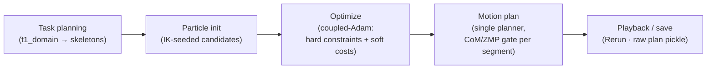
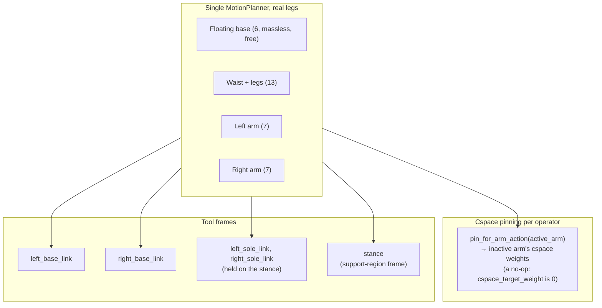

# cuTAMP with Booster T1

## Quick Links

The full README with installation instructions, examples, and detailed
documentation can be found in [README_DETAILED.md](README_DETAILED.md).

cuTAMP plans on one model, the real-legs T1: bfm_wm's T1 on its home stance.
The simplified 21-DOF model and the paper's ablation reproduce from branch `ablation-baseline` (cuTAMP f29516b with fork f4e4ff2), and the G1-era code from tag `paper-g1-comfix`.

> **cuRobo fork dependency:** cuTAMP relies on local edits to the vendored
> `curobo/` tree (the `compute_com` plumbing; the CoM-aware seed-IK
> residual, whose solution is kept for each problem the seed IK solved, so
> the CoM-blind optimizer replaces only the failed ones; the URDF parser's
> link-CoM and link-mass fixes; a thread-safety fix for warp stream
> wrappers; and a seed-IK LM fix — 10 Python source files, no kernel
> changes; the earlier batched-COM kernel fix was dropped
> when the base moved to NVlabs PR #678, which fixes it upstream). The edits
> live on the `main` branch of the cuRobo fork (helpYoon/curobo) — a plain
> NVlabs checkout without them breaks cuTAMP, and its parser puts each
> link's CoM at R p + p instead of p (twice the offset for an unrotated
> inertial frame). Grep `cuTAMP` under
> `curobo/curobo/_src/` for the tagged ones (6 files tagged `cuTAMP fork`,
> plus `robot_state_transition[_cfg].py` tagged `cuTAMP local addition`);
> two are untagged: `solver/seed_ik/seed_iteration_state_manager.py` (it
> keeps the current objective when an LM step is rejected) and
> `robot/parser/parser_urdf.py` (a link's CoM is its inertial origin's
> translation, and a massless link weighs 0, not 0.01 kg).
> `git -C curobo diff ac5f931 main` (ac5f931 is the NVlabs base) lists them all.
> Without the `util/warp.py` fix, the background motion-planner build
> thread can crash the process with heap corruption
> (`malloc(): unaligned tcache chunk detected`).
>
> Set `SETUPTOOLS_SCM_PRETEND_VERSION=0.8.0` for every command: the fork's
> tags break setuptools_scm's version lookup, so without it `import curobo`
> fails with an `AssertionError`. Only `python -m …` and
> `pytest cutamp/tests/` run from the repo root get by without it (the
> `curobo/` checkout there shadows the package); `cutamp-demo` fails even
> there.

## How it works (end-to-end)

cuTAMP solves a task-and-motion problem for the T1 by searching over **plan
skeletons** (symbolic action sequences) and, for each, optimizing a batch of
**particles** (candidate continuous parameters — grasps, placements, configs)
until one satisfies every hard constraint, then motion-planning the result.



1. **Task planning** — `task_plan_generator` (`cutamp/task_planning/`) enumerates
   PDDL-style plan skeletons over the T1 operators in `t1_domain.py`
   (`LeftPick`, `RightPlace`, `LeftRetractHolding`, …), breadth-first, trying
   the closer arm for each object first (`make_arm_affinity_priority_fn`).
2. **Particle initialization** — `ParticleInitializer`
   (`particle_initialization.py`) seeds a batch of candidate grasps / placements
   / configs (`samplers.py`) and runs cuRobo IK — with CoM-aware seed-IK, and
   both soles' goals on the home stance (`sole_goals`) — for each pick / place
   conf, re-solving particles whose CoM leaves the model's keyframe rectangle
   (`world.model.support.keyframe_half`). Retract confs start at the model's
   home (`REAL_LEGS.home`).
3. **Optimization** — `ParticleOptimizer` (`optimize_plan.py`) runs Adam over the
   particles against `CostFunction` (`cost_function.py`): hard constraints
   (kinematic — the hand's pose and both soles on the stance — motion,
   collision, stable-placement, and the `ComPolygon` gate: every conf's CoM
   inside the model's keyframe rectangle, which sits 5 mm inside its support
   region for the arrival's deceleration: the stance's two soles shrunk 2 cm
   and another 5 mm, where each foot carries at least a tenth of the weight,
   `support_rectangles`) plus soft costs. Adam is always **re-IK-coupled** —
   outer Adam moves poses while the confs an IK target covers are re-projected
   every `reik_interval` steps by balance-first Gauss-Newton (`gn_refresh.py`:
   the CoM in the support rectangle and both soles on the stance first, then
   the pose, every step kept inside the joint limits), with no cuRobo during
   Adam and the Adam step and refresh replayed as CUDA graphs
   (`cuda_graphs.py`); the final pre-check refresh repairs rows that miss
   tolerance or leave the CoM polygon with the full cuRobo IK.
   Adam stops after `early_stop_patience` steps without progress and keeps the
   best-seen particles. `ConstraintChecker` decides which particles satisfy.
4. **Motion planning** — `_motion_plan_with_retries` (`algorithm.py`) drives
   the best satisfying particles (up to `motion_plan_max_retries`, first
   success wins) through `motion_solver.py`: one `MotionPlanner` over the
   model's cspace, built on a background thread while the optimizer runs,
   re-pinned per operator (`pin_for_arm_action`, a no-op), and planned to each
   particle conf with `plan_cspace`. Trajopt holds both soles on the stance at
   every waypoint and bounds every joint's torque at its effort with cuRobo's
   RNEA, the floor's push on the soles included (`install_floor_wrench`). Each
   segment then passes `_balance_gate`: every frame must keep both soles on
   the stance (and the Trunk's tilt within the envelope's bound, where it sets
   one), and its CoM inside the model's support rectangle
   (`world.model.support.gate_half`: the home stance's two soles, shrunk 2 cm
   and kept where each foot carries at least a tenth of the weight). A CoM
   outside fails the candidate and the next one is tried. The gate then sets
   the segment's pace: the smallest uniform time scale, faster or slower than
   the planner's and up to 4× (`RETIME_MAX`), at which every actuated joint's
   speed stays within cuRobo's limit, every joint's torque, cuRobo's RNEA with
   the floor's push on the soles (`SegmentTorques`), within its effort, and
   the multibody ZMP (`com_zmp_in_support`) inside. The frames it returns are
   checked again, and a segment no scale up to 4× passes fails the candidate,
   naming the check.
5. **Playback / save** — the Rerun visualizer renders every trajectory (both
   arms' held objects tracked); `--save_plan` pickles the plan raw
   (`stage3-raw`, `raw_motion_plan` in `utils/plan_processor.py`): per segment,
   positions, velocities and accelerations in the model's joint order at
   cuRobo's interpolation dt, until stage 6's schema-4 export. A segment the
   gate retimed (slowed down or sped up) also carries `planner_timing`, the
   same segment at the motion planner's own timing (`None` otherwise).

`run_cutamp` (`algorithm.py`) orchestrates these stages; `setup_cutamp` builds
the shared `TAMPWorld`.

## T1 Single-Planner Architecture (cuRobo v0.8)

cuTAMP plans for the T1 humanoid through a **single MotionPlanner** on one
planning model, `REAL_LEGS` (`T1Model` in `robots/t1.py`): bfm_wm's T1
(`assets/t1_29dof/`) on a six-joint floating base, built from `t1_29dof.yml`.
Its cspace, in cuRobo's order (`t1_29dof.yml`'s `joint_order`), is:

```
6 base      (base_j_x, base_j_y, base_j_z, base_j_pitch, base_j_roll, base_j_yaw)   ← massless, free
7 left arm  (Left_Shoulder_Pitch ... Left_Hand_Roll)
7 right arm (Right_Shoulder_Pitch ... Right_Hand_Roll)
1 Waist
12 legs     (Left/Right_Hip_Pitch, _Hip_Roll, _Hip_Yaw, _Knee_Pitch, then Left/Right_Ankle_Pitch, _Ankle_Roll)
= 33 DOF
```

The head and gripper joints are locked (`lock_joints`). The floating base is a
virtual chain of massless `extra_links`
(`world → base_link_x → … → base_link_yaw → Trunk`) whose limits are the
legs' reach, and nothing locks it: IK, GN and the planner move it with the
legs. Both soles stand on the home stance: the IK's sole goals, GN's sole
rows, the kinematic constraint and trajopt's sole tracking hold them there.
The kinematics exposes five tool frames: the hands (`left_base_link`,
`right_base_link`), the soles (`left_sole_link`, `right_sole_link`) and
`stance`, a world-fixed frame at the home mid-sole on the floor that is the
support region's frame. Per-arm IK builds one `GoalToolPose` over every tool
frame (`_build_multi_frame_goal`): the active hand gets the target, the soles
their stance poses, and the others stay at their FK pose at the IK's start
conf, which is what holds the idle hand. The planner's dynamics include the
floor's push on the soles.



There is no per-arm "shared joint" propagation — the body joints are
genuinely shared in one cspace, so trajopt updates them coherently. The
inactive arm's tool moves through world during single-arm planning: the base,
legs and Waist carry it, and `plan_cspace` holds nothing between the endpoint
confs (the pin is a no-op). The visualizer tracks both arms' held objects
through every trajectory (see `T1State.compute_all_held_obj_poses`).

## Layout

### 📁 [`cutamp/robots/`](cutamp/robots/)

- **[`assets/t1_29dof/`](cutamp/robots/assets/t1_29dof/)** — the planning
  model: a pinned copy of bfm_wm's T1 (`urdf/T1_29dof.urdf`, its `meshes/`,
  `t1_actuators.npz` and the licence; `PROVENANCE.yml` gives each file's
  source and sha1) and `build_planner_model.py`, which derives the planner's
  `t1_planner.urdf` (the vendor URDF plus a `world` link and cuTAMP's gripper),
  `t1_29dof.yml` and `t1_29dof_spheres.yml` from it, cuTAMP's gripper and the
  hand-kept upper-body spheres (`upper_body_spheres.yml`); a rerun reproduces
  all three byte for byte. `write_mujoco_fixture.py` writes
  `mujoco_fixture.npz` (MuJoCo's FK, masses, inertias and soft limits on
  bfm_wm's `t1.xml`), which the tests check the model against.
- **[`assets/t1_description/`](cutamp/robots/assets/t1_description/)** —
  cuTAMP's gripper: `gripper.urdf` (the links and joints the builder appends
  to each hand, weightless), its STL `meshes/`, and
  `left_gripper_spheres.pt` / `right_gripper_spheres.pt`, the pre-fit gripper
  spheres grasp sampling uses. `actual_meshes/` holds 60 STLs of Booster's T1
  that no URDF or code references.
- **[`assets/envelopes/`](cutamp/robots/assets/envelopes/)** —
  `route_a_start.yml`, route A's envelope: the joint ranges the planner
  enforces (the Waist's) and a Trunk floor and tilt bound, both unset; the
  rest is stored for later stages.
- [`assets/README.md`](cutamp/robots/assets/README.md) — short index of the
  asset files.

- [`__init__.py`](cutamp/robots/__init__.py) — `RobotContainer` and its
  factory `load_t1_container(model)`. The container's tool frames are the two
  hands; tool↔EE transforms account for T1's +X-toward-fingertips EE
  convention.

- [`envelope.py`](cutamp/robots/envelope.py) — `Envelope` and
  `load_envelope`, the envelope a policy is trained on.

- [`t1.py`](cutamp/robots/t1.py) — T1 module:
  - `T1Model`, the planning model as data, and its one instance `REAL_LEGS`:
    the cspace and its joint groups (`base`, `body`, `left_arm`,
    `right_arm`), home, support region (`Support`: its frame, centre,
    `gate_half` and `keyframe_half`), sole frames and envelope, to which
    `t1_curobo_cfg` cuts the model's limits.
  - cuRobo loaders: `get_t1_kinematics` (always `compute_com=True`;
    `compute_jacobian=True` for the GN refresh), `get_t1_ik_solver` (a single
    multi-tool-frame IK over both arms, every joint free; its seed-IK LM stage
    carries a CoM residual — a cuRobo fork edit — over the largest
    frame-centred box inside the model's keyframe rectangle, which on the
    stance is the rectangle itself, weighted by `T1_COM_IK_WEIGHT` and the
    pull-to-center `T1_COM_IK_CENTER_WEIGHT`), `get_t1_motion_planner` (the
    single planner: cuRobo's RNEA in trajopt with the floor's push on the
    planted soles and each joint's torque bounded at its effort, the soles held
    on the stance at every waypoint, the COM-over-polygon rollout soft cost,
    and the Trunk-tilt cost where the envelope sets a bound), and
    `get_t1_bodies` (a `T1Bodies` of every massive link, with cuRobo's
    masses and CoMs and the URDF's inertias, for the balance gate's
    multibody ZMP).
  - The arm joint names (`LEFT_ARM_JOINT_NAMES`, `RIGHT_ARM_JOINT_NAMES`), the
    tool frames and the grippers' open and closed states.
  - `T1RerunRobot` for visualization: sets the URDF's joints by name from a
    conf in the model's cspace (the six base joints give the Trunk's world
    pose, `trunk_pose_from_q`, logged as the root transform), the fingers from
    `set_grippers` and the head at its locked values. Playback reprojects the
    planner's trajectories to the model's full cspace first.

### 📁 [`cutamp/`](cutamp/) — core

- [`tamp_world.py`](cutamp/tamp_world.py) — `TAMPWorld` wraps a
  TAMPEnvironment with the collision Scene, the single `Kinematics` (built
  with `compute_com=True`), a single multi-tool-frame `InverseKinematics`
  solver, and a `MotionPlanner` factory. `q_init` is the model's home. It
  also holds the stance (`stance_soles`, `sole_goals`). Built lazily:
  `kinematics_jac` (the Jacobian twin for the GN refresh), `bodies`
  (`get_t1_bodies`: a second `Kinematics` whose tool frames are every massive
  link, for the balance gate's multibody ZMP), `segment_torques` (the gate's
  torque and speed checks), and one `site_kinematics(name)` per Adam-loop FK
  site in `FK_SITES`.

- [`t1_state.py`](cutamp/t1_state.py) — `T1State` carries the planner, the
  per-tool-frame `tool_from_ee`, and per-arm `arm_holding` /
  `arm_grasp_transform`. Cspace pinning lives here:
  - `pin_for_arm_action(arm)` — write the inactive arm's cspace pin weights
    (a no-op: `cspace_target_weight` is 0).
  - `unpin()` — restore original weights.
  - `compute_held_obj_poses(arm, plan)` — per-timestep `world_from_obj` for a
    held object along a planner trajectory.
  - `compute_all_held_obj_poses(plan)` — `{arm: (obj_name, poses)}` for every
    arm currently holding (visualization needs both because the inactive
    arm's tool still translates with the body).

- [`_curobo_internals.py`](cutamp/_curobo_internals.py) — the cuRobo
  private-API helpers shared across modules, in one file (with `# TODO: file
  upstream issue` markers; one-off workarounds stay beside their callers:
  `motion_solver._attach_object` / `_detach_object`,
  `particle_initialization._achieved_pose_errors`): `get_attachment_manager`, `cspace_plan_succeeded`,
  `iter_rollouts`, the cspace target-weight `write…` / `snapshot…` /
  `restore…` trio (hosts-iterable), `build_pin_weights`, and
  `add_extra_cost` (custom-cost dispatch; effective for the planner's
  rollouts — for IK solve-time costs it is inert, which is why the CoM
  residual lives inside the seed-IK fork instead).

- [`com_polygon_cost.py`](cutamp/com_polygon_cost.py) — single source of
  truth for the balance geometry: `support_rectangles`, which gives the
  stance's trajectory-gate and keyframe rectangles from the soles' geometry,
  the load guard (`LOAD_GUARD_A`, a tenth of the weight on each foot),
  `COM_SAFETY_MARGIN` (2 cm) and `COM_DYNAMIC_RESERVE` (a further 5 mm);
  `COM_INSIDE_MARGIN` / `COM_INSIDE_WEIGHT` and `COM_TOL`; and the soles'
  tolerances (`SOLE_POS_TOL`, `SOLE_ROT_TOL`, `soles_planted`). Its
  consumers: `com_polygon_penalty` (outside-quadratic + inside-margin barrier),
  `ComOverBasePolygonCost` (the planner rollout cost),
  `compute_com_polygon_penalties` (the hard `ComPolygon` constraint),
  `compute_com_polygon_mask` (the post-IK COM-safe retry and the final
  refresh's repair check), `compute_com_margin` (the planned particle's static
  margin in the run metrics), and for the trajectory gate
  `com_zmp_in_support` (each frame's CoM and multibody ZMP) and
  `compute_support_mask` (the audit's mask on
  `world.model.support.gate_half`).

- [`joint_limit_cost.py`](cutamp/joint_limit_cost.py) —
  `joint_limit_margin_soft_cost` (the `joint_limit_margin` soft cost: a
  hinge² penalty on segment-endpoint confs past the joint limits, which are
  bfm_wm's soft limits, so there is no band), and the Trunk tilt bound an
  envelope may set: `trunk_tilt_excess` (the Motion value `trunk_tilt`),
  `TrunkTiltCost` on the planner, and GN's tilt row.

- [`floor_wrench.py`](cutamp/floor_wrench.py) — the floor's push on the
  planted soles: `install_floor_wrench` hooks it into trajopt's RNEA, and
  `SegmentTorques` runs cuRobo's two RNEA passes with it on a plan's frames.

- [`motion_solver.py`](cutamp/motion_solver.py) — drives the plan skeleton
  through the single planner (`build_motion_planner`). Per-operator: pin the
  cspace, plan to the particle's conf with `plan_cspace`, then pass
  `_balance_gate`: every frame keeps both soles on the stance (and the
  Trunk's tilt within the envelope's bound, where it sets one) and its CoM
  inside `world.model.support.gate_half`, and the gate times each segment at
  the smallest uniform scale its speed, torque and ZMP checks pass: the
  speed's and the torque's exactly, the ZMP's by a batched search to within
  `RETIME_TOL` = 2% above it, all on the planner's frames with the velocities
  over s and the accelerations over s², up to `RETIME_MAX` = 4×. It resamples
  the segment at that scale (`_retime`, a C² cubic spline) and checks the
  frames it returns again (`_recheck`). Each segment is appended to
  `accum_plans` (with `held_objs` for both arms; a retimed one also keeps
  `planner_timing`, the same spline at the planner's own timing), then the
  object is attached/detached via the AttachmentManager. Playback walks
  `accum_plans` and hands each entry to the visualizer. The run metrics get
  the gate's `retime_min` and `retime_max` (below 1 where it sped a segment
  up), `retime_binding` (segments per binding check: `velocity <joint>`,
  `torque <joint>`, `zmp`, or `none` where none binds),
  `traj_com_min_margin` and `traj_zmp_min_margin`, plus
  `plan_duration_s` and the measure-only audit `traj_com_violation_frac` /
  `traj_com_frames` against the gate's rectangle.

- [`particle_initialization.py`](cutamp/particle_initialization.py) — IK-seeded
  particle init for `LeftPick` / `RightPick` / `LeftPlace` / etc.
  `_ik_for_pose_com_safe` re-solves particles whose COM leaves the polygon
  from noisier seeds that stand on the stance (`_retry_seed`).
  `_build_multi_frame_goal` builds the
  `GoalToolPose` covering every tool frame for single-arm actions: the
  active frame gets the target pose, the soles their stance poses, while each
  inactive hand keeps its ENABLED pose criteria, targeting its FK pose at the
  IK's start conf: home in particle init, a perturbed home seed in the
  CoM-safe retries, or the current particle in the final refresh's repair.

- [`samplers.py`](cutamp/samplers.py) — grasp / placement / yaw samplers
  (`grasp_4dof_sampler`, `place_4dof_sampler`,
  `sample_yaw`) that seed the continuous particles.

- [`task_planning/`](cutamp/task_planning/) — the symbolic layer:
  `task_plan_generator` runs breadth-first search (`search.py`) over the domain
  structs (`tamp_structs.py`, `base_structs.py`, `constraints.py`, `costs.py`)
  to emit plan skeletons.

- [`t1_domain.py`](cutamp/t1_domain.py) — TAMP domain (fluents + operators)
  for T1: `LeftAt` / `RightAt`, `LeftHolding` / `RightHolding`,
  `LeftMoveFree` / `RightMoveFree`, `LeftMoveHolding` / `RightMoveHolding`,
  `LeftPick` / `RightPick`, `LeftPlace` /
  `RightPlace`, and `LeftRetractHolding` / `RightRetractHolding`,
  `LeftRetractFree` / `RightRetractFree`.

- [`config.py`](cutamp/config.py) — `TAMPConfiguration` (only T1 supported)
  and `SUPPORTED_SOFT_COSTS`. Notable defaults: `num_particles=256`;
  `soft_cost=["place_close_to_base", "joint_limit_margin",
  "minimize_body_movement"]` (what `None` resolves to; `[]` runs none); the
  balance-first GN refresh every `reik_interval=5` steps; `cuda_graphs=True`
  (`uses_cuda_graphs`: runs with `align_yaw` stay eager);
  `early_stop_patience=150`; `motion_plan_max_retries=10`.

- [`algorithm.py`](cutamp/algorithm.py) — `setup_cutamp` + `run_cutamp`
  outer loop. The motion-plan retry sweep lives in `_motion_plan_with_retries`:
  a cuRobo failure or a balance-gate rejection moves on to the next
  candidate, skipping candidates that repeat a failed plan, and every failed
  candidate's message goes into the run metrics (`motion_plan_failures`).

- [`optimize_plan.py`](cutamp/optimize_plan.py) — Adam-based optimization over
  particles; respects `left_q0` / `right_q0` as fixed initial-state. Holds the
  re-IK dependencies (`IKDep`), the balance-first refresh
  (`_refresh_balanced`) and the final pre-check refresh's cuRobo repair, the
  best-seen snapshot and early stop (`_BestSnapshot`), per-refresh stats
  (`_ReikDriftGate`), and the CUDA step and refresh graphs
  (`G_step`, `G_refresh`; `--no_cuda_graphs` runs them eagerly).

- [`gn_refresh.py`](cutamp/gn_refresh.py) — batched damped Gauss-Newton
  projection of the warm conf onto a moved pose target, balance first:
  `gn_project_balanced`, whose level 1 keeps the CoM in the keyframe
  rectangle and both soles on the stance (and the Trunk's tilt within an
  envelope's bound), and whose level 2 is the pose, least squares inside it,
  every step scaled inside the joint limits, with no cuRobo during Adam.
  `gn_gate` checks the result against the checker's tolerances for the refresh
  stats.

- [`cuda_graphs.py`](cutamp/cuda_graphs.py) — `CapturedGraph` capture and
  replay of those graphs, refusing a replay once a device address it
  baked in has moved.

- [`cost_function.py`](cutamp/cost_function.py) — hard constraints
  (kinematic, with both soles against the stance; motion; collision; stable
  placement; and the `ComPolygon` CoM-in-rectangle gate on the model's
  keyframe rectangle, over every `q_*` conf) plus the soft costs listed in
  `SUPPORTED_SOFT_COSTS` (`place_close_to_base`, `joint_limit_margin`,
  `retract_close_to_home`, `minimize_body_movement`, the multi-object
  placement costs, …). `_compute_soft_cost` hard-codes the names, so a new
  soft cost goes in both places.

- [`costs.py`](cutamp/costs.py) — low-level differentiable cost primitives
  (`trajectory_length`, sphere-overlap, AABB, `curobo_pose_error`) that
  `cost_function.py` composes.

- [`constraint_checker.py`](cutamp/constraint_checker.py) — `ConstraintChecker`
  evaluates which particles satisfy every hard constraint (the satisfying set).

- [`cost_reduction.py`](cutamp/cost_reduction.py) — `CostReducer` reduces the
  cost dict to one weighted cost per particle (multipliers from
  `scripts/utils.py`), which ranks the candidates.

- [`experiment_logger.py`](cutamp/experiment_logger.py) — `ExperimentLogger`
  records per-run metrics and timings.

- [`rollout.py`](cutamp/rollout.py) — FK rollout helpers used by the cost
  graph (forward kinematics on the model's full cspace).

- [`conf_locking.py`](cutamp/conf_locking.py) — per-conf gradient masks
  (`build_grad_masks` / `apply_grad_masks`) that zero the inactive arm's
  DOFs, and for a retract conf the base and body too, so Adam can't move them.

- [`envs/`](cutamp/envs/) — `TAMPEnvironment`, `load_env`, and
  `raise_surface_height` (`--surface_height`);
  `assets/blocks_t1.yml` is the only env (two blocks and a goal pad on the
  ground).

- [`utils/visualizer.py`](cutamp/utils/visualizer.py) — Rerun visualizer.
  `log_joint_trajectory_with_mat4x4s(traj, mat4x4s, …)` accepts any number
  of held-object transforms per trajectory.

- [`utils/plan_processor.py`](cutamp/utils/plan_processor.py) —
  `raw_motion_plan` builds the plan `--save_plan` writes, schema `stage3-raw`:
  per segment, the model's joints' positions, velocities and accelerations at
  cuRobo's interpolation dt, and `planner_timing` for a segment the gate
  retimed (else `None`).

- Other [`utils/`](cutamp/utils/): `collision.py` (`WorldCollisionCost`,
  sphere-vs-scene distance), `common.py` (pose / transform helpers,
  `get_world_cfg`), `shapes.py` (`sample_greedy_surface_spheres`),
  `rerun_utils.py`, and `timer.py` (`TorchTimer`, GPU-synchronized timing).

### 📁 [`cutamp/tests/`](cutamp/tests/) — 269 tests in 37 files

Shared fixtures live in [`conftest.py`](cutamp/tests/conftest.py)
(`needs_cuda` marker, `make_blocks_t1_world` factory, the module-scoped
`real_world` and `blocks_t1_plan` worlds, GPU-memory cleanup, and the bitwise
comparator `assert_bitwise`). Highlights:

- [`test_t1_robot_module.py`](cutamp/tests/test_t1_robot_module.py) — the
  container (one `Kinematics`, two hand tool frames, gripper spheres),
  kinematics smoke, the raw plan's layout and the Rerun robot.
- [`test_t1_real_legs_model.py`](cutamp/tests/test_t1_real_legs_model.py),
  [`test_t1_29dof_assets.py`](cutamp/tests/test_t1_29dof_assets.py) and
  [`test_envelope.py`](cutamp/tests/test_envelope.py) — the planning model as
  data (its layout, the soft-cost default, the removed options, the support
  rectangles, the world on the home stance), the pinned assets and their
  byte-identical rebuild, and route A's envelope.
- [`test_com_polygon_ik.py`](cutamp/tests/test_com_polygon_ik.py) — COM
  penalty math, mask/gate parity, the post-IK COM-safe retry, gradient
  checks, and a guard on cuRobo's batched-COM kernel (fixed upstream in PR
  #678).
- [`test_com_aware_seed_ik.py`](cutamp/tests/test_com_aware_seed_ik.py) —
  CoM-aware seed-IK: the solver's CoM parameters, fork/cuTAMP penalty parity,
  gradients FD-checked on every joint, centering A/B with joint-limit and
  pose-accuracy guards, and an unsolved problem keeping the others centred.
- [`test_motion_anchor.py`](cutamp/tests/test_motion_anchor.py) —
  cspace-anchored pick/place terminals, the trajectory audit, and one
  blocks_t1 plan's balance metrics against its exported frames.
- [`test_balance_gate.py`](cutamp/tests/test_balance_gate.py) — `_retime`'s
  endpoints and the planner timing it keeps, and `get_t1_bodies`' config
  hygiene.
- [`test_robot_com.py`](cutamp/tests/test_robot_com.py) — cuRobo's URDF
  parser (each link's CoM, mass and inertia, on a test URDF) and the real
  legs' body inertias against the URDF's.
- [`test_gn_refresh.py`](cutamp/tests/test_gn_refresh.py),
  [`test_gn_balanced_step.py`](cutamp/tests/test_gn_balanced_step.py) and
  [`test_real_legs_gn.py`](cutamp/tests/test_real_legs_gn.py) — the GN
  refresh, including the Jacobian-convention guard, the balance-first core,
  and GN holding the soles, the CoM and the tilt.
- [`test_step_lockstep.py`](cutamp/tests/test_step_lockstep.py) and the
  `test_cuda_graphs*.py` files — every Adam step bitwise against its twin and
  the reference math; every graph replay bitwise against eager; and across
  two optimize calls, the bytes the tensors request stay the same.
- The other `test_real_legs_*.py` files and
  [`test_floor_wrench.py`](cutamp/tests/test_floor_wrench.py) — particle init
  on the stance, the support checks, FK orientation gradients, the gate's
  sole, tilt, CoM, torque and speed checks and the pace they set, the floor's
  push, the real-leg report, and a run end to end.
- Plus pin lifecycle, arm-affinity priority, motion attach / retry, the
  plan's `dt` label, the static stability margin, cost reduction, the
  best-seen snapshot, the drift gate, the capture-safe step, goal_in_xy's
  fixed-order sum, the FK sites, surface spheres, the cuRobo workarounds, and
  a coupled-reIK smoke test.

Run with:
`SETUPTOOLS_SCM_PRETEND_VERSION=0.8.0 python -m pytest -q cutamp/tests`
(GPU required for the integration tests; on an RTX 4090 on 2026-11-05: 264
passed, 5 skipped in 37 files, 3 min 27 s; the 37 warnings are yourdfpy's
NumPy DeprecationWarnings in `test_t1_29dof_assets.py`).
`CUTAMP_SLOW=1` also runs the 5 slow live tests: 3 `--cuda_graphs` runs in
[`test_cuda_graphs_live.py`](cutamp/tests/test_cuda_graphs_live.py), the floor
hook on a live motion planner in
[`test_floor_wrench.py`](cutamp/tests/test_floor_wrench.py) and the
end-to-end run in
[`test_real_legs_motion.py`](cutamp/tests/test_real_legs_motion.py)
(those three files with `CUTAMP_SLOW=1`: 40 passed in 1 min 18 s).

### 📁 [`cutamp/scripts/`](cutamp/scripts/)

- [`run_cutamp.py`](cutamp/scripts/run_cutamp.py) — main entry point
  (installed as `cutamp-demo`). T1 / `blocks_t1` only (no `--env` flag, no
  other envs); `--surface_height` raises the blocks and goal pad, `--seed`
  seeds the sampling, and `--save_plan PATH` (or `auto`, or no value:
  `motion_plan.pkl` next to the run's metrics) saves the raw plan
  (`stage3-raw`, the model's joints).
- [`real_legs_report.py`](cutamp/scripts/real_legs_report.py) — the saved
  plans under a directory of `run_cutamp` experiment directories: per joint,
  the peak torque against its effort and the peak speed against the motor's
  knee speed and cuRobo's limit; per run, the largest Trunk tilt and sole
  drift, the segments the gate slowed and sped up, its margins, time scales
  and binding checks, and any planner-timed segment past an effort
  (`PREFIX.json`, `PREFIX.md`).
- [`utils.py`](cutamp/scripts/utils.py) — the default cost multipliers and
  constraint tolerances, and `setup_logging`.
- [`gripper_sphere_editor.py`](cutamp/scripts/gripper_sphere_editor.py) —
  interactive gripper-sphere editor: it writes the `.pt` files in
  `t1_description/` and the gripper links in `upper_body_spheres.yml`.
- [`robot_sphere_editor.py`](cutamp/scripts/robot_sphere_editor.py) —
  interactive robot-sphere editor of `t1_29dof/upper_body_spheres.yml`,
  against `t1_planner.urdf`. After saving either, rerun
  `build_planner_model.py`. Both editors build on
  [`_sphere_editor_common.py`](cutamp/scripts/_sphere_editor_common.py) and
  need `open3d` (the `editor` extra).

## Usage

By default a run plans on bfm_wm's T1 on its home stance with 256 particles
and the soft costs `place_close_to_base`, `joint_limit_margin` and
`minimize_body_movement`, optimized under re-IK-coupled Adam with the
balance-first GN refresh replayed as CUDA graphs, and CoM-aware IK, so
placements stay near the base, the body stays near its home, and every
arrival lands with its CoM inside the keyframe rectangle
(`joint_limit_margin` has no band: the limits are already bfm_wm's soft
limits). With `--motion_plan`, every trajectory frame also keeps both soles
on the stance and its CoM and ZMP inside the soles shrunk 2 cm: the gate sets
each segment's pace, up to 4×, and a candidate that still fails is dropped
(`motion_solver._balance_gate`).

```bash
# Smoke test (no motion plan)
python -m cutamp.scripts.run_cutamp -n 16 --num_opt_steps 50

# Full run with motion planning, no visualizer
python -m cutamp.scripts.run_cutamp --motion_plan -n 64 --disable_visualizer

# With Rerun visualizer
python -m cutamp.scripts.run_cutamp --motion_plan -n 64

# Save the raw plan (stage3-raw) next to the run's metrics
python -m cutamp.scripts.run_cutamp --motion_plan -n 64 --save_plan auto

# Different soft costs (replaces the default list)
python -m cutamp.scripts.run_cutamp --motion_plan \
    --soft_cost retract_close_to_home minimize_body_movement

# Eager Adam steps and refreshes (no CUDA graphs)
python -m cutamp.scripts.run_cutamp --motion_plan --no_cuda_graphs

# Several runs, each saving its plan, then the real-leg report over them
for s in 0 1 2; do
    python -m cutamp.scripts.run_cutamp --motion_plan -n 64 --save_plan auto \
        --disable_visualizer --seed $s --experiment_root /tmp/study --experiment_id run_s$s
done
python -m cutamp.scripts.real_legs_report --study /tmp/study --out /tmp/study/real_legs
```

**Available soft costs** (see `SUPPORTED_SOFT_COSTS`):
- `place_close_to_base` *(default)* — pull placed objects toward the base;
  keeps placements inside the reach range where the CoM-aware IK can center
  the COM.
- `joint_limit_margin` *(default)* — a hinge² penalty on segment-endpoint
  confs past the joint limits; the limits are already bfm_wm's soft limits,
  so there is no band and the cost is zero inside them. It acts on the confs
  Adam optimizes: the confs an IK target covers (pick, place) are outside
  Adam, and the GN refresh keeps its steps inside the joint limits.
- `retract_close_to_home` — penalize retract configs far from the model's
  home.
- `minimize_body_movement` *(default)* — penalize body (legs and Waist)
  drift from home.
- `dist_from_origin`, `max_obj_dist` / `min_obj_dist`, `min_y` / `max_y`,
  `align_yaw` — multi-object placement costs.

Pose-class soft costs (e.g. `place_close_to_base`) are optimized through the
re-IK coupling: outer Adam moves pose/grasp particles while their dependent
confs are re-projected every `reik_interval` steps (balance-first
Gauss-Newton, no cuRobo during Adam; the final pre-check refresh still
repairs with cuRobo IK).

## Key Design Decisions

1. **Single MotionPlanner** — cuRobo v0.8's `GoalToolPose` takes a
   target for every tool frame of a kinematics that exposes both arms (the
   inactive frames get their current FK pose), and the planner then plans
   every segment in cspace, so we no longer need
   two MotionGens or per-arm "shared joint" propagation.

2. **Floating base via `extra_links`** — `world → base_link_x → … →
   base_link_yaw → Trunk` adds six massless virtual joints (x, y, z, pitch,
   roll, yaw), free in IK, GN and the planner and limited to the legs' reach.
   The soles stay on the stance instead: IK's sole goals, GN's sole rows, the
   kinematic constraint and trajopt's sole tracking hold them there.

3. **Inactive-arm handling** — `pin_for_arm_action` writes the inactive
   arm's per-DOF `cspace_target_dof_weight` into the optimizer rollouts of
   the planner's trajopt solver and of its internal IK solver (restored by
   `unpin()`), and particle-init and refresh IK write the same weights for
   each call. The pin is a no-op: cuRobo scales those weights by
   `cspace_target_weight`, which is 0 in every IK and trajopt config used,
   and cuRobo zeroes it again when it builds the cost. The term's target is
   also a zero joint vector, not the arm's current joints. What holds the
   inactive hand is IK's multi-frame goal, which targets that frame where it
   is, at the confs IK solves. The optimizer's gradient masks and the GN
   refresh keep the inactive arm's joints fixed, so that hand rides with the
   trunk when they move the body, and `plan_cspace` holds nothing between
   confs. Both arms are in the optimizer's collision constraints and the
   planner's collision checks, with three gaps: GN checks no collision (the
   optimizer rescores every conf each step), a pick or place segment
   disables its block or support surface for the whole robot, and a segment
   the balance gate retimes (slows down or speeds up) is resampled through
   the planner's frames (`_retime`) without new collision or joint-limit
   checks on the in-between frames.

4. **Both arms tracked through every trajectory** — body joints are unlocked
   during single-arm planning, so an inactive arm holding a block will still
   translate that block through world. `compute_all_held_obj_poses` returns
   poses for every holding arm so the visualizer renders both correctly.

5. **Retract after pick/place** — the per-arm `RetractHolding` (collision checks
   exclude held object) and `RetractFree` (empty gripper) operators move toward
   the model's home after each manipulation. Retract confs start at that home,
   with their base and body locked there, so only the active arm moves; the
   hard collision, joint-limit and `ComPolygon` constraints, the default
   `joint_limit_margin` soft cost and the opt-in `retract_close_to_home`
   shape the result.

6. **cuRobo internals isolated** — every workaround that reaches into cuRobo's
   private API lives in
   [`cutamp/_curobo_internals.py`](cutamp/_curobo_internals.py) so a
   future cuRobo upgrade has one place to audit. The exceptions are the
   one-off workarounds beside their callers (`_attach_object` /
   `_detach_object`, `_achieved_pose_errors`), plain `curobo._src` imports
   (the cost base classes and `SelfCollisionCost`, `utils/collision.py`'s
   scene collision, `config_io`) and the fork edits inside the vendored
   `curobo/` tree itself (grep `cuTAMP`, plus two untagged ones: the seed-IK
   fix in `seed_iteration_state_manager.py` and the link-CoM and link-mass
   fixes in `parser_urdf.py`; `git -C curobo diff ac5f931 main` lists them
   all); those must travel with any cuRobo upgrade, or the link CoMs come
   back wrong.

7. **Layered COM safety** — the COM is kept inside the model's support region
   (every trajectory frame) and its keyframe rectangle, 5 mm further in:
   `support_rectangles`' two rectangles, centred on the stance
   (`com_polygon_cost.py`). Independent layers each guard a different
   frontier:
   - **CoM-aware seed-IK** (cuRobo fork residual): the IK itself trades hand
     pose vs COM, recruiting the legs within joint limits, with a
     pull-to-center term on a frame-centred box (`get_t1_ik_solver`) —
     endpoint confs come out near the stance's centre, not edge-parked.
   - **Hard `ComPolygon` gate**: every optimizer conf must have COM penalty
     ≤ `COM_TOL`; a post-IK mask + retry backstops the IK.
   - **Balance-first re-IK refresh**: covered confs are outside Adam, so the
     GN refresh puts the CoM and the soles first (the pose is least squares
     inside them) and the final pre-check refresh repairs any row still
     outside with the CoM-aware cuRobo IK.
   - **COM-anchored terminals**: pick/place trajectories end exactly at the
     gate-approved conf (`plan_cspace`), so cuRobo can't re-resolve the
     redundancy at the endpoint.
   - **Planner rollout COM cost**: a soft barrier (`ComOverBasePolygonCost`)
     pushes mid-trajectory frames toward the keyframe rectangle between
     anchored endpoints; it cannot guarantee them.
   - **Trajectory balance gate** (`motion_solver._balance_gate`,
     `--motion_plan` only): every frame's CoM and multibody ZMP
     (`com_zmp_in_support`, from the plan's own velocities and
     accelerations) must stay inside the gate's rectangle, with both soles on
     the stance. A CoM exit fails the candidate; the ZMP, with each joint's
     speed and torque, sets the segment's uniform time scale (up to
     `RETIME_MAX` = 4×) instead of letting it tip, and a segment no scale
     passes fails the candidate.
   - **`place_close_to_base`** (default soft cost): biases chosen placements
     away from the far-reach regime where no in-limit posture can center
     the COM.

   The run metrics also record measure-only CoM numbers:
   `com_in_polygon_per_conf` and `best_com_margin` after Adam, and
   `traj_com_violation_frac` after the motion plan.
