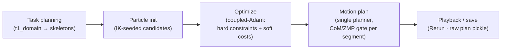

# cuTAMP with Booster T1

cuTAMP plans on one model, the real-legs T1: bfm_wm's T1 on its home stance.
The simplified 21-DOF model and the paper's ablation reproduce from branch
`ablation-baseline` (cuTAMP f29516b with fork f4e4ff2), and the G1-era code
from tag `paper-g1-comfix`. Both need the cuRobo fork helpYoon/curobo (with
`SETUPTOOLS_SCM_PRETEND_VERSION=0.8.0`), installed from a checkout of its own:
`curobo/` here is the v0.9.0 submodule.

> **cuRobo dependency:** cuTAMP runs on unmodified NVlabs cuRobo v0.9.0 (tag
> `v0.9.0`, commit 42498cf), pinned as the git submodule `curobo/`, with
> warp-lang 1.16 ([Installation](#installation)).
> Everything cuTAMP changes in cuRobo lives in
> [`cutamp/_curobo_internals.py`](cutamp/_curobo_internals.py), applied on
> `import cutamp`, which first checks the source of each cuRobo function it
> patches or relies on and refuses to run on any cuRobo but v0.9.0:
> - a URDF link with no inertial weighs 0, not cuRobo's 0.01 kg (the T1 has
>   11: `world` and the 10 gripper links);
> - one warp stream wrapper per CUDA stream: warp 1.16.0 registers every new
>   wrapper in a native stream map with no lock, so the background
>   motion-planner build thread, launching beside the main thread, would
>   corrupt the heap (`malloc(): unaligned tcache chunk detected`);
> - trajopt's transitions compute the CoM and run RNEA a second time with the
>   floor's push on the soles (`set_external_wrench_fn`, installed by
>   `floor_wrench.install_floor_wrench`);
> - extra trajopt costs get dispatched (cuRobo's cost manager calls only its
>   own six).
>
> cuRobo still applies `velocity_scale` twice (open PR NVlabs/curobo#729), so
> the planner reads joint limits back from cuRobo. Its timeopt (on by default)
> retimes each plan to torque limits on its own RNEA, without the floor's push,
> so `get_t1_motion_planner` turns it off and the balance gate paces each
> segment. Trajopt's first solve runs 100 L-BFGS iterations, not v0.9.0's 50:
> on the five blocks_t1 cases v0.9.0 planned worst, 50 planned 4 and 100 all 5
> (`TRAJOPT_INITIAL_ITERS`). cuRobo's FK backward adds each link's sphere and
> tool-frame gradients with float atomics, whose order varies between warps.
> Since stage 4's line segments (each pick's and place's straight insert and
> leave), a line segment, most often a right-hand one, can differ by 1.55e-6
> to 8.52e-4 rad between same-seed runs. Particle init also sometimes accepts
> different IK confs in same-seed runs, while the motion planner is being
> built. So same-seed plans are usually, not always, bit-identical.

## Installation

cuTAMP needs Linux on x86_64 (planning needs GraspGenX, below), an NVIDIA GPU
that [cuRobo supports](https://github.com/NVlabs/curobo/blob/v0.9.0/docs/getting-started/installation.rst)
(newer than Turing, with a driver >= 580.65.06) and
[uv](https://docs.astral.sh/uv/getting-started/installation/). `uv sync`
builds `.venv` from `uv.lock`: Python 3.10, PyTorch 2.9.1 for CUDA 12.8
(from the PyTorch index), warp-lang 1.16.0 (warp 1.10.1 fails on
`launch_bounds`) and the `curobo/` submodule, editable, with its `cu12` extra.
The exact pins in `pyproject.toml` are the versions the v0.9.0 plans were
accepted on. cuRobo v0.9.0 compiles its kernels when they first run (NVRTC,
with the headers from its `cu12` extra's NVIDIA wheels), so its install builds
nothing; cuTAMP keeps the compiled kernels in
`${XDG_CACHE_HOME:-~/.cache}/cutamp/nvrtc`, so a run compiles (3-4 s in all)
only the kernels this checkout and toolchain have not compiled before.

```bash
# cuRobo v0.9.0 comes as curobo/ and GraspGenX as GraspGenX/; the variable skips GraspGenX's git-LFS files
GIT_LFS_SKIP_SMUDGE=1 git clone --recursive https://github.com/helpYoon/cuTAMP.git
cd cuTAMP
uv sync  # --extra editor adds the sphere editor's open3d
```

Run commands with `uv run` (`uv run python -m cutamp.scripts.run_cutamp ...`,
`uv run pytest`) or after `source .venv/bin/activate`. Both put `.venv/bin`,
which holds the Rerun viewer that `run_cutamp` spawns, on `PATH`.

A clone made without `--recursive` gets both submodules with
`GIT_LFS_SKIP_SMUDGE=1 git submodule update --init`, and so does a checkout
that pulls or merges a commit adding a submodule: until then that submodule's
folder is empty, and `uv sync` and `uv run` fail. Both are shallow
(`shallow = true` in `.gitmodules`): each fetches its pinned commit only, about
136 MB for cuRobo and 18 MB for GraspGenX, not its whole history.

[GraspGenX](https://github.com/NVlabs/GraspGenX) (6-DoF grasps) is pinned at
`b9429097`. On x86_64, `uv sync` installs it editable into the same env with its
`serve` extra. One of its dependencies, sharedarray, builds from source, so that
needs a C compiler. Planning needs GraspGenX, since every world loads its
grasps from it, so cuTAMP plans on x86_64 only: on aarch64 `uv sync` leaves
GraspGenX out, because its scene tools need `usd-core`, and setup stops with a
`RuntimeError` that names the platform and this paragraph. Its pins on torch,
torchvision, numpy, trimesh and yourdfpy are overridden to cuTAMP's
(`override-dependencies` in `pyproject.toml`). Its
179 MB of LFS gripper meshes and sample data are not needed: GraspGenX can take
the hand as a sweep volume (`GraspGenXSampler.from_sweep_volume`). Before
anything imports `graspgenx`, point two variables at existing folders:
`GRASPGENX_CHECKPOINT_DIR` at the model and `GRASPGENX_GRIPPER_CFG_DIR` at any
folder, which may be empty.
Otherwise its first import clones the newest heads of two Hugging Face repos,
about 2 GB, into `GraspGenX/ext/`. The model is
`adithyamurali/GraspGenXModel` at `7c834043` (1.69 GB):

```bash
M=~/graspgenx-model/7c834043; SHA=7c834043c11a11417e31d6d5ea9355801e40a2c1
for f in release/gen/config.yaml release/gen/epoch_736.pth release/dis/config.yaml release/dis/epoch_1056.pth; do
  curl -fL --create-dirs -o $M/$f https://huggingface.co/adithyamurali/GraspGenXModel/resolve/$SHA/$f
done
sha256sum -c <<EOF
8b55f31cdb8340a573b4df27b027c15cff326bd6debcb389bf631d2aaab7ac44  $M/release/gen/epoch_736.pth
cbf3f3bdb2e4c03fca8486ed24de0e6a8a859e6bd22bce2f1434a610335abd3e  $M/release/dis/epoch_1056.pth
EOF
mkdir -p ~/graspgenx-model/no-gripper-descriptions
export GRASPGENX_CHECKPOINT_DIR=$M GRASPGENX_GRIPPER_CFG_DIR=~/graspgenx-model/no-gripper-descriptions
```

The planner runs GraspGenX in its own process: when the world loads,
`grasp_sets` ([`cutamp/grasps.py`](cutamp/grasps.py)) makes each object
shape's 6-DoF grasps once, in about 3.6 s per process (`generate_grasps`, timed
apart from the planning time), and there is no grasp server or grasp file. It
sets either variable that is unset or empty to its folder above
(`~/graspgenx-model/7c834043`, `~/graspgenx-model/no-gripper-descriptions`)
and stops with an error naming this paragraph if a folder is missing, before
anything imports `graspgenx`. Any other script that imports `graspgenx` must
set both variables itself.

cuRobo's own [install guide](https://github.com/NVlabs/curobo/blob/v0.9.0/docs/getting-started/installation.rst)
has the details.

## How it works (end-to-end)

cuTAMP solves a task-and-motion problem for the T1 by searching over **plan
skeletons** (symbolic action sequences) and, for each, optimizing a batch of
**particles** (candidate continuous parameters — grasps, placements, configs)
until one satisfies every hard constraint, then motion-planning the result.



1. **Task planning** — `task_plan_generator` (`cutamp/task_planning/`) enumerates
   PDDL-style plan skeletons over the T1 operators in `t1_domain.py`
   (`LeftPick`, `RightPlace`, `LeftRetractHolding`, …), breadth-first, trying
   the closer arm for each object first (`make_arm_affinity_priority_fn`).
2. **Particle initialization** — `ParticleInitializer`
   (`particle_initialization.py`) seeds a batch of candidate grasps / placements
   / configs and solves each pick / place conf with GN IK
   (`gn_ik`): balance-first Gauss-Newton from home and from three noisy starts
   on the stance in one batch, first reaching and then clearing any collision
   with the scene, the robot itself and the movable objects, the clearing
   iterations also pulling the CoM toward the keyframe rectangle's centre so
   a conf doesn't park on its edge, and the Trunk toward upright. Each target
   keeps its most upright accepted start, and a conf is accepted only inside the checker's
   tolerances (`ik_check`): the hand, both soles on the stance, the CoM in the
   model's keyframe rectangle (`world.model.support.keyframe_half`) and no
   collision. Retract confs start at the model's home
   (`REAL_LEGS.home`). Each pick first tries every grasp of its object that the
   hand can take (`world.grasp_candidates`: none with a hand sphere below the
   object's bottom face or touching the object, `grasps.drop_grasps`), top or
   side, from any direction: one IK row per grasp at the pick and one at its
   place, on a placement drawn for it. Of the grasps balanced at both, those
   GraspGenX scores at `GRASP_SCORE_CUTOFF` (0.7, its own cutoff) or more rank
   upright first: the Trunk's tilt, then its travel from home, then the CoM
   margin, each at the worse of the pick and the place, with ties going by
   GraspGenX's order. The first `motion_plan_max_retries` of them are the
   pick's chosen grasps; when fewer clear the cutoff, the best-scoring balanced
   ones below it fill the rest (`choose_grasps`). The particles take the chosen
   grasps in turn, each keeping its grasp's pick conf where `ik_check` accepts
   it in the particle's own scene. Where no grasp is balanced, the pick draws
   by score as before and logs a warning. Each place row draws its placement
   (`place_4dof_sampler`), its yaw turned so the held grasp approaches from the
   robot's side. The rows whose IK fails draw again, up to
   `GRASP_REDRAW_ROUNDS` times, a pick from its chosen grasps. Grasps are never
   optimized.
3. **Optimization** — `ParticleOptimizer` (`optimize_plan.py`) runs Adam over the
   particles against `CostFunction` (`cost_function.py`): hard constraints
   (kinematic — the hand's pose and both soles on the stance — motion,
   collision, stable-placement, and the `ComPolygon` gate: every conf's CoM
   inside the model's keyframe rectangle, which sits 5 mm inside its support
   region for the arrival's deceleration: the stance's two soles shrunk 2 cm
   and another 5 mm, where each foot carries at least a tenth of the weight,
   `support_rectangles`) plus soft costs. Adam is always **re-IK-coupled** —
   outer Adam moves poses while the confs an IK target covers are re-projected
   every `reik_interval` steps by balance-first Gauss-Newton (`gn_refresh.py`:
   the CoM in the support rectangle, both soles on the stance and no
   collision first, then the pose, every step kept inside the joint limits),
   with no cuRobo during Adam and the Adam step and refresh replayed as CUDA
   graphs (`cuda_graphs.py`).
   Adam stops after `early_stop_patience` steps without progress and keeps the
   best-seen particles. `ConstraintChecker` decides which particles satisfy.
4. **Motion planning** — `_motion_plan_with_retries` (`algorithm.py`) drives
   up to `motion_plan_max_retries` satisfying particles, first success wins,
   taken round their grasp groups (`get_top_satisfying_particles`: groups
   whose grasps all score 0.7 or more first, then upright first on each
   group's best particle by soft cost), through `motion_solver.py`: one
   `MotionPlanner` over the model's cspace, built on a background thread while
   the optimizer runs, and planned to each particle conf with `plan_cspace` (2
   attempts per segment; if no particle plans, those that ran out of attempts
   get cuRobo's 20), so a pick or place
   ends exactly at the conf the optimizer approved and cuRobo can't
   re-resolve the redundancy at the endpoint. Each pick and place is three
   segments: an approach to a pre conf, a straight insert to the particle conf
   and a straight leave to a post conf (`grasps.approach_targets`). A pick
   comes in along the hand's approach from `APPROACH_DISTANCE` back and leaves
   the same way, or lifts `LIFT_HEIGHT` straight up if its approach is more
   than `VERTICAL_CONE` from vertical; a place comes in the same way, or,
   past that cone, from `LIFT_HEIGHT` above, and always backs out along its
   approach. GN solves the
   pre and post confs (`_approach_confs`), trajopt holds the hand on each line
   (`_line_motion`) and FK checks it (`check_line`). Trajopt holds both soles on the
   stance at every waypoint and bounds every joint's torque at its effort with
   cuRobo's RNEA, the floor's push on the soles included
   (`install_floor_wrench`). Each
   segment then passes `_balance_gate`: every frame must keep both soles on
   the stance and its CoM inside the model's support rectangle
   (`world.model.support.gate_half`: the home stance's two soles, shrunk 2 cm
   and kept where each foot carries at least a tenth of the weight). A CoM
   outside fails the candidate and the next one is tried. The gate then sets
   the segment's pace: the smallest uniform time scale, never faster than the
   planner's and up to 4× slower (`RETIME_MAX`), at which every actuated joint's
   speed stays within cuRobo's limit, every joint's torque, cuRobo's RNEA with
   the floor's push on the soles (`SegmentTorques`), within its effort, and
   the multibody ZMP (`com_zmp_in_support`, from the same RNEA's floor
   wrench) inside. The frames it returns are
   checked again, and a segment no scale up to 4× passes fails the candidate,
   naming the check.
5. **Playback / save** — the Rerun visualizer renders every trajectory (both
   arms' held objects tracked); `--save_plan` pickles the plan raw
   (`stage4-raw`, `raw_motion_plan` in `utils/plan_processor.py`): per segment,
   its arm, its op's index, its phase (`approach`, `insert`, `lift`,
   `back_out` or `retract`) and the gripper event at its end, and positions,
   velocities and accelerations in the model's joint order at
   cuRobo's interpolation dt, until stage 6's schema-4 export. A segment the
   gate slowed down also carries `planner_timing`, the
   same segment at the motion planner's own timing (`None` otherwise).

`run_cutamp` (`algorithm.py`) orchestrates these stages; `setup_cutamp` makes
the grasps (`grasp_sets`) and builds the shared `TAMPWorld`.

## T1 Single-Planner Architecture (cuRobo v0.9.0)

cuTAMP plans for the T1 humanoid through a **single MotionPlanner** on one
planning model, `REAL_LEGS` (`T1Model` in `robots/t1.py`): bfm_wm's T1
(`assets/t1_29dof/`) on a six-joint floating base, built from `t1_29dof.yml`.
Its cspace, in cuRobo's order (`t1_29dof.yml`'s `joint_order`), is:

```
6 base      (base_j_x, base_j_y, base_j_z, base_j_pitch, base_j_roll, base_j_yaw)   ← massless, free
7 left arm  (Left_Shoulder_Pitch ... Left_Hand_Roll)
7 right arm (Right_Shoulder_Pitch ... Right_Hand_Roll)
1 Waist
12 legs     (Left/Right_Hip_Pitch, _Hip_Roll, _Hip_Yaw, _Knee_Pitch, then Left/Right_Ankle_Pitch, _Ankle_Roll)
= 33 DOF
```

The head and gripper joints are locked (`lock_joints`). The floating base is a
virtual chain of massless `extra_links`
(`world → base_link_x → … → base_link_yaw → Trunk`) whose limits are the
legs' reach, and nothing locks it: GN (the IK and the refresh) and the
planner move it with the legs. Both soles stand on the home stance: GN's sole
rows, the kinematic constraint and trajopt's sole tracking hold them there.
The kinematics exposes five tool frames: the hands (`left_base_link`,
`right_base_link`), the soles (`left_sole_link`, `right_sole_link`) and
`stance`, a world-fixed frame at the home mid-sole on the floor that is the
support region's frame. GN moves the base, the body and the active arm; the
idle arm keeps its start joints, so that hand rides with the trunk. The
planner's dynamics include the floor's push on the soles.

There is no per-arm "shared joint" propagation — the body joints are
genuinely shared in one cspace, so trajopt updates them coherently. The
inactive arm's tool moves through world during single-arm planning: the base,
legs and Waist carry it, and `plan_cspace` holds nothing between the endpoint
confs. The visualizer tracks both arms' held objects through every trajectory
(`motion_solver._held_obj_poses`).

## Layout

### 📁 [`cutamp/robots/`](cutamp/robots/)

- **[`assets/t1_29dof/`](cutamp/robots/assets/t1_29dof/)** — the planning
  model: a pinned copy of bfm_wm's T1 (`urdf/T1_29dof.urdf`, its `meshes/`,
  `t1_actuators.npz` and the licence; `PROVENANCE.yml` gives each file's
  source and sha1) and `build_planner_model.py`, which derives the planner's
  `t1_planner.urdf` (the vendor URDF plus a `world` link and cuTAMP's gripper),
  `t1_29dof.yml` (the cuRobo robot config, with a `cutamp:` block cuRobo never
  reads) and `t1_29dof_spheres.yml` from it, cuTAMP's gripper and the
  hand-kept upper-body spheres (`upper_body_spheres.yml`, gripper links
  included); a rerun reproduces all three byte for byte.
  `write_mujoco_fixture.py` writes `mujoco_fixture.npz` (MuJoCo's FK, masses,
  inertias and soft limits on bfm_wm's `t1.xml`), which the tests check the
  model against.
- **[`assets/t1_description/`](cutamp/robots/assets/t1_description/)** —
  cuTAMP's gripper: `gripper.urdf` (the links and joints the builder appends
  to each hand, weightless) and its 10 STL `meshes/`. Its collision spheres
  sit on each hand's base link in `t1_29dof_spheres.yml`, which both cuRobo
  and the grasp drops (`get_t1_gripper_spheres`, `TAMPWorld.hand_spheres`)
  read. `graspgenx/sweep_volume.json` is the hand as GraspGenX takes it, its
  swept volume (`scripts/graspgenx_sweep_volume.py`).
- **[`assets/envelopes/`](cutamp/robots/assets/envelopes/)** —
  `route_a_start.yml`, route A's envelope: the joint ranges the planner
  enforces (the Waist's, and the ankle pitches' up to home, so no plan pitches
  a shin back past the home stance); the rest is stored for later stages.

- [`__init__.py`](cutamp/robots/__init__.py) — `RobotContainer` and its
  factory `load_t1_container(model)`. The container's tool frames are the two
  hands; tool↔EE transforms account for T1's +X-toward-fingertips EE
  convention.

- [`envelope.py`](cutamp/robots/envelope.py) — `Envelope` and
  `load_envelope`, the envelope a policy is trained on.

- [`t1.py`](cutamp/robots/t1.py) — T1 module:
  - `T1Model`, the planning model as data, and its one instance `REAL_LEGS`:
    the cspace and its joint groups (`base`, `body`, `left_arm`,
    `right_arm`), home, support region (`Support`: its frame, whose origin is
    the region's centre, `gate_half` and `keyframe_half`), sole frames and
    envelope, to which `t1_curobo_cfg` cuts the model's limits (each end on
    its own, in a copy of the planner URDF, since cuRobo reads a URDF joint's
    limits only from the URDF).
  - cuRobo loaders: `get_t1_kinematics` (always `compute_com=True`; the
    world builds its other `Kinematics` on its config),
    `get_t1_motion_planner` (the
    single planner: cuRobo's RNEA in trajopt with the floor's push on the
    planted soles and each joint's torque bounded at its effort, the joint
    limits bounded at `TRAJOPT_POSITION_BOUND_WEIGHT` (1e6, cuRobo's 1e4
    times 100, so paths that end on the ankle cap stay inside it), the soles held
    on the stance at every waypoint and the COM-over-polygon rollout soft
    cost).
  - The arm joint names (`LEFT_ARM_JOINT_NAMES`, `RIGHT_ARM_JOINT_NAMES`), the
    tool frames and the grippers' open and closed states.
  - `T1RerunRobot` for visualization: sets the URDF's joints by name from a
    conf in the model's cspace (the six base joints give the Trunk's world
    pose, `trunk_pose_from_q`, logged as the root transform), the fingers from
    `set_grippers` and the head at its locked values. Playback reorders the
    planner's trajectories to the model's cspace first, dropping the head and
    finger joints they also carry (`motion_solver._full_positions`).

### 📁 [`cutamp/`](cutamp/) — core

- [`tamp_world.py`](cutamp/tamp_world.py) — `TAMPWorld` wraps a
  TAMPEnvironment with the collision Scene and the single `Kinematics` (built
  with `compute_com=True`); it builds no IK solver (the IK is GN's, `gn_ik`)
  and no planner (`motion_solver.build_motion_planner` does). `q_init` is the
  model's home. It also holds the stance (`stance_soles`), the movables'
  GraspGenX grasps (`grasps`, same-shaped movables share one set), each hand's
  spheres for the grasp drops (`hand_spheres`) and each object and arm's grasps
  that pass them (`grasp_candidates`). Built lazily:
  `kinematics_jac` (the Jacobian twin for GN), `segment_torques` (the gate's
  torque, speed and ZMP checks), and one `site_kinematics(name)` per Adam-loop
  FK site in `FK_SITES`; all run on the single `Kinematics`'s config.

- [`_curobo_internals.py`](cutamp/_curobo_internals.py) — everything cuTAMP
  changes in cuRobo, in one file (with a `# TODO: file upstream issue` marker;
  one-off workarounds stay beside their callers: `motion_solver._attach_object`
  / `_detach_object`): `install_curobo_patches` (run on `import cutamp`: the
  source check, the parser's mass floor and the warp stream cache),
  `set_external_wrench_fn` (RNEA's second pass) and `add_extra_cost`
  (custom-cost dispatch on the planner's trajopt optimizer rollouts).

- [`com_polygon_cost.py`](cutamp/com_polygon_cost.py) — single source of
  truth for the balance geometry: `support_rectangles`, which gives the
  stance's trajectory-gate and keyframe rectangles from the soles' geometry,
  the load guard (`LOAD_GUARD_A`, a tenth of the weight on each foot),
  `COM_SAFETY_MARGIN` (2 cm) and `COM_DYNAMIC_RESERVE` (a further 5 mm);
  `COM_INSIDE_MARGIN` / `COM_INSIDE_WEIGHT` and `COM_TOL`; and the soles'
  tolerances (`SOLE_POS_TOL`, `SOLE_ROT_TOL`, `soles_planted`). Its
  consumers: `com_polygon_penalty` (outside-quadratic + inside-margin barrier),
  `ComOverBasePolygonCost` (the planner rollout cost),
  `compute_com_polygon_penalties` (the hard `ComPolygon` constraint),
  `com_polygon_mask_from_state` (GN IK's acceptance and `gn_gate`),
  `particle_com_margin` (a particle's static margin through
  `compute_com_margin`, for the run metrics' measure-only `best_com_margin`
  after Adam and `planned_com_margin` for the planned particle), and for the
  trajectory gate `com_zmp_in_support` (each frame's CoM and multibody ZMP,
  the ZMP from the floor's wrench, RNEA's first-pass base wrench).

- [`joint_limit_cost.py`](cutamp/joint_limit_cost.py) —
  `joint_limit_margin_soft_cost` (the `joint_limit_margin` soft cost: a
  hinge² penalty on segment-endpoint confs past the joint limits, which are
  bfm_wm's soft limits cut by the envelope, so there is no band), and
  `trunk_tilt_cosine`, the cosine of the Trunk's tilt, by which `gn_ik` ranks
  each target's accepted starts.

- [`floor_wrench.py`](cutamp/floor_wrench.py) — the floor's push on the
  planted soles: `install_floor_wrench` hooks it into trajopt's RNEA, and
  `SegmentTorques` runs cuRobo's two RNEA passes with it on a plan's frames;
  its `floor` is the first pass's base wrench, the floor's wrench on the robot,
  from which the gate takes the ZMP.

- [`motion_solver.py`](cutamp/motion_solver.py) — drives the plan skeleton
  through the single planner (`build_motion_planner`). Per operator, each
  segment plans to a conf with `plan_cspace` (a pick or place three, each
  tagged with its phase: approach, insert, then lift or back-out; a retract
  one), then passes `_balance_gate`: every
  frame keeps both soles on the stance and its CoM inside
  `world.model.support.gate_half`, and the gate times each segment at the
  smallest uniform scale from 1 (the planner's own timing) up that its speed,
  torque and ZMP checks pass, each exactly (the torques and the floor's wrench
  are linear in 1/s²), on the planner's frames with the velocities over s and
  the accelerations over s², up to `RETIME_MAX` = 4×. It resamples the segment
  at that scale (`_retime`, a C² cubic spline) and checks the frames it
  returns again (`_recheck`). Each segment is appended to `accum_plans` (with
  `held_objs`, `_held_obj_poses` for every arm holding an object; a slowed one
  also keeps `planner_timing`, the same spline at the planner's own timing),
  then the object is attached/detached via the AttachmentManager. A held
  mesh is fit on its convex hull (`held_fit_obstacle`): cuRobo's VOXEL fit
  inscribes its spheres, and a thin wall such as cup_t1's holds none of use.
  Playback
  walks `accum_plans` and hands each entry to the visualizer. The run metrics
  get the gate's `retime_min` and `retime_max`, `retime_binding` (segments per
  binding check: `velocity <joint>`, `torque <joint>`, `zmp`, or `none` where
  none binds), `traj_com_min_margin` and `traj_zmp_min_margin`, plus
  `plan_duration_s`.

- [`particle_initialization.py`](cutamp/particle_initialization.py) — IK-seeded
  particle init for `LeftPick` / `RightPick` / `LeftPlace` / etc. `gn_ik` is
  the planner's only IK: multi-start balance-first GN (home, plus
  noisy starts that stand on the stance, `_noisy_start`), 30
  reaching iterations without the collision row and 10 with it (the iterates
  are not motions, so only the result must be collision-free), then
  `ik_check` on the checker's tolerances; each target keeps its accepted
  start whose Trunk tilts least (accepted starts' hand errors tie), else the
  safe one (every check but the hand's) with the smallest hand error, else
  the one with the smallest hand error. The movable objects' spheres at each
  conf come from `rollout.movable_spheres_fn`, placed as the rollout places
  them. A pick row takes one of its pick's chosen grasps (a pool walk solves
  every eligible grasp once, then `choose_grasps`) and a place row draws its
  placement, and the rows whose IK fails draw again (`_draw_and_solve`; a
  placement keeps the least-colliding of its candidates, `_draw_placements`).

- [`grasps.py`](cutamp/grasps.py) — the grasps: `grasp_sets` runs
  GraspGenX's graspmoe planner on each object shape's surface points when the
  world loads (its diffusion grasps and the box grasps on the top and the
  sides, all kept with their scores), seeded, so every process gets the same
  grasps. A grasp is a 6-DoF pose of GraspGenX's gripper frame in the object
  frame, `[x, y, z, qw, qx, qy, qz]`. Here too: init's drop rule
  (`drop_grasps`), each pick's and place's targets (`approach_targets`,
  `is_vertical`) and their knobs, search settings rather than robot limits
  (`APPROACH_DISTANCE`, `LIFT_HEIGHT`, `VERTICAL_CONE`, the place yaw's
  `AZIMUTH_CONE`, `GRASP_REDRAW_ROUNDS`, and the line check's `LINE_TOL`,
  `LINE_BACKTRACK` and `LINE_END_TOL`). So does `GRASP_SCORE_CUTOFF`,
  GraspGenX's own 0.7, the score from which a grasp counts as holding well
  enough.

- [`samplers.py`](cutamp/samplers.py) — the placement and yaw samplers
  (`place_4dof_sampler`, `sample_yaw`); grasps come from GraspGenX
  (`grasps.py`).

- [`task_planning/`](cutamp/task_planning/) — the symbolic layer:
  `task_plan_generator` runs breadth-first search (`search.py`) over the domain
  structs (`tamp_structs.py`, `base_structs.py`, `constraints.py`, `costs.py`)
  to emit plan skeletons.

- [`t1_domain.py`](cutamp/t1_domain.py) — TAMP domain (fluents + operators)
  for T1, built per arm by one factory for the fluents and one for the
  operators, so the two sides mirror each other: `LeftAt` / `RightAt`,
  `LeftHolding` / `RightHolding`, …, and `LeftMoveFree`, `LeftMoveHolding`,
  `LeftPick`, `LeftPlace`, `LeftRetractHolding`, `LeftRetractFree` and their
  `Right…` twins.

- [`config.py`](cutamp/config.py) — `TAMPConfiguration` (only T1 supported)
  and `SUPPORTED_SOFT_COSTS`. Notable defaults: `num_particles=256`;
  `soft_cost=["place_close_to_base", "joint_limit_margin",
  "minimize_body_movement"]` (what `None` resolves to; `[]` runs none); the
  balance-first GN refresh every `reik_interval=5` steps; `cuda_graphs=True`;
  `early_stop_patience=50`; `motion_plan_max_retries=10`.

- [`algorithm.py`](cutamp/algorithm.py) — `setup_cutamp` + `run_cutamp`
  outer loop. The motion-plan retry sweep lives in `_motion_plan_with_retries`:
  a cuRobo failure or a balance-gate rejection moves on to the next
  candidate, skipping candidates that repeat a failed plan, and every failed
  plan's message, over both attempt passes, goes into the run metrics
  (`motion_plan_failures`).

- [`optimize_plan.py`](cutamp/optimize_plan.py) — Adam-based optimization over
  particles; respects `left_q0` / `right_q0` as fixed initial-state. Holds the
  re-IK dependencies (`IKDep`), the balance-first refresh
  (`_refresh_balanced`), the best-seen snapshot and early stop (`_BestSnapshot`), per-refresh stats
  (`_ReikDriftGate`), and the CUDA step and refresh graphs
  (`G_step`, `G_refresh`; `--no_cuda_graphs` runs them eagerly).

- [`gn_refresh.py`](cutamp/gn_refresh.py) — batched damped Gauss-Newton
  projection of the warm conf onto a moved pose target, balance first:
  `gn_project_balanced`, whose level 1 keeps the CoM in the keyframe
  rectangle, both soles on the stance, the robot out of collision with the
  scene, itself and the movable objects (one row on the summed penetration,
  `collision_penetration`, aimed 5 mm past contact, a solver margin), whose
  level 2 is the pose, least
  squares inside it, whose level 3, beside the collision row, pulls the
  CoM toward the rectangle's centre in the freedom left (`_centring_step`; on
  every iteration but the last, and a row in contact, or whose step would end
  in contact or with a CoM axis past the rectangle,
  takes levels 1-2's step), and whose level 4, below it, pulls the Trunk
  toward upright, the base's pitch and roll toward 0 (`_upright_step`; a row
  whose level-3 step is taken back takes neither, and one whose level-4 step
  would end in contact takes levels 1-3's), every step
  scaled inside the joint limits, with no cuRobo during Adam. `gn_gate` checks the result against the checker's
  tolerances for the refresh stats; it checks no collision.

- [`cuda_graphs.py`](cutamp/cuda_graphs.py) — `CapturedGraph` capture and
  replay of those graphs, refusing a replay once a device address it
  baked in has moved.

- [`cost_function.py`](cutamp/cost_function.py) — hard constraints
  (kinematic, with both soles against the stance; motion; collision; stable
  placement; and the `ComPolygon` CoM-in-rectangle gate on the model's
  keyframe rectangle, over every `q_*` conf) plus the soft costs listed in
  `SUPPORTED_SOFT_COSTS` (`place_close_to_base`, `joint_limit_margin`,
  `retract_close_to_home`, `minimize_body_movement`). `_compute_soft_cost`
  hard-codes the names, so a new soft cost goes in both places.

- [`costs.py`](cutamp/costs.py) — low-level differentiable cost primitives
  (`trajectory_length`, sphere-overlap, AABB, `curobo_pose_error`) that
  `cost_function.py` composes.

- [`constraint_checker.py`](cutamp/constraint_checker.py) — `ConstraintChecker`
  evaluates which particles satisfy every hard constraint (the satisfying set).

- [`cost_reduction.py`](cutamp/cost_reduction.py) — `CostReducer` reduces the
  cost dict to one weighted cost per particle (multipliers from
  `scripts/utils.py`), which ranks the candidates.

- [`experiment_logger.py`](cutamp/experiment_logger.py) — `ExperimentLogger`
  records per-run metrics and timings.

- [`rollout.py`](cutamp/rollout.py) — FK rollout helpers used by the cost
  graph (forward kinematics on the model's full cspace).

- [`conf_locking.py`](cutamp/conf_locking.py) — per-conf gradient masks
  (`build_grad_masks` / `apply_grad_masks`) that zero the inactive arm's
  DOFs, and for a retract conf the base and body too, so Adam can't move them.

- [`envs/`](cutamp/envs/) — `TAMPEnvironment`, `load_env` (it normalizes
  each pose's quaternion and resolves a mesh's `file_path` against the env
  file's folder), `resolve_env_path` (`--env`: a shipped name or a path) and
  `raise_surface_height` (`--surface_height`: the movables and surfaces go up
  onto a static `table` top, `TABLE_THICKNESS` thick with its top at the
  height, that covers their xy box; the floor and the other statics stay
  put). Each scene in `assets/` has a `floor`, a static cuboid whose top is at
  z = 0:
  - `blocks_t1`: two blocks and a goal pad on the floor;
  - `shelf_t1`: a box on the lower of two boards, to be placed on a pad on
    the same board. The upper board leaves no room for a top-down hand, so
    the box needs a side or angled grasp. It runs at height 0, and the box
    stands on the robot's left, since a one-object scene plans the left arm
    first;
  - `cylinder_t1` and `cup_t1`: a standing cylinder, and a cup mesh
    (`meshes/cup.obj`, from `scripts/make_cup_mesh.py`), each with
    blocks_t1's pad, run at `--surface_height 0.5`.

- [`utils/visualizer.py`](cutamp/utils/visualizer.py) — Rerun visualizer.
  `log_joint_trajectory_with_mat4x4s(traj, mat4x4s, …)` accepts any number
  of held-object transforms per trajectory.

- [`utils/plan_processor.py`](cutamp/utils/plan_processor.py) —
  `raw_motion_plan` builds the plan `--save_plan` writes, schema `stage4-raw`:
  per segment, its arm, op index, phase and gripper event, and the model's
  joints' positions, velocities and accelerations at
  cuRobo's interpolation dt, and `planner_timing` for a segment the gate
  retimed (else `None`).

- Other [`utils/`](cutamp/utils/): `collision.py` (`WorldCollisionCost`,
  the sphere-vs-scene collision cost), `common.py` (pose / transform helpers,
  `get_world_cfg`), `shapes.py` (`sample_greedy_surface_spheres`),
  `rerun_utils.py`, and `timer.py` (`TorchTimer`, GPU-synchronized timing).

### 📁 [`cutamp/tests/`](cutamp/tests/)

Each test file's docstring says what it checks; shared fixtures and helpers
live in [`conftest.py`](cutamp/tests/conftest.py). Run with:
`uv run python -m pytest -q cutamp/tests`
(GPU required for the integration tests). `CUTAMP_SLOW=1` also runs the slow
live `--cuda_graphs` runs in
[`test_cuda_graphs_live.py`](cutamp/tests/test_cuda_graphs_live.py).

### 📁 [`cutamp/scripts/`](cutamp/scripts/)

- [`run_cutamp.py`](cutamp/scripts/run_cutamp.py) — main entry point
  (installed as `cutamp-demo`), T1 only. `--env` picks the scene, a shipped
  name (`blocks_t1`, the default, `shelf_t1`, `cylinder_t1`, `cup_t1`) or an
  env file's path; `--surface_height` raises its movables and surfaces onto a
  table top, `--seed` seeds the sampling, and `--save_plan PATH` (or `auto`,
  or no value: `motion_plan.pkl` next to the run's metrics) saves the raw
  plan (`stage4-raw`, the model's joints).
- [`graspgenx_sweep_volume.py`](cutamp/scripts/graspgenx_sweep_volume.py) —
  the hand's swept volume as GraspGenX takes it (two boxes in its gripper
  frame and a fingertip depth), from the gripper's meshes, into
  `t1_description/graspgenx/sweep_volume.json`.
- [`make_cup_mesh.py`](cutamp/scripts/make_cup_mesh.py) — writes cup_t1's
  `meshes/cup.obj`, a revolved, watertight cup.
- [`real_legs_report.py`](cutamp/scripts/real_legs_report.py) — the saved
  plans under a directory of `run_cutamp` experiment directories: per joint,
  the peak torque against its effort and the peak speed against the motor's
  knee speed and cuRobo's limit; per run, the largest Trunk tilt and sole
  drift, the segments the gate slowed, its margins, time scales
  and binding checks, and any planner-timed segment past an effort
  (`PREFIX.json`, `PREFIX.md`).
- [`utils.py`](cutamp/scripts/utils.py) — the default cost multipliers and
  constraint tolerances, and `setup_logging`.
- [`robot_sphere_editor.py`](cutamp/scripts/robot_sphere_editor.py) —
  interactive collision-sphere editor of `t1_29dof/upper_body_spheres.yml`
  (the gripper links included), against `t1_planner.urdf`. After saving,
  rerun `build_planner_model.py`. It needs `open3d` (the `editor` extra).

## Usage

By default a run plans on bfm_wm's T1 on its home stance with 256 particles
and the soft costs `place_close_to_base`, `joint_limit_margin` and
`minimize_body_movement`, optimized under re-IK-coupled Adam with the
balance-first GN refresh replayed as CUDA graphs, and balance-first GN IK, so
placements stay near the base, the body stays near its home, and every
arrival lands with its CoM inside the keyframe rectangle
(`joint_limit_margin` has no band: the limits are already bfm_wm's soft
limits). With `--motion_plan`, every trajectory frame also keeps both soles
on the stance and its CoM and ZMP inside the soles shrunk 2 cm: the gate slows
each segment as needed, up to 4×, and a candidate that still fails is dropped
(`motion_solver._balance_gate`).

```bash
# Smoke test (no motion plan)
uv run python -m cutamp.scripts.run_cutamp -n 16 --num_opt_steps 50

# Full run with motion planning, no visualizer
uv run python -m cutamp.scripts.run_cutamp --motion_plan -n 64 --disable_visualizer

# With Rerun visualizer
uv run python -m cutamp.scripts.run_cutamp --motion_plan -n 64

# Save the raw plan (stage4-raw) next to the run's metrics
uv run python -m cutamp.scripts.run_cutamp --motion_plan -n 64 --save_plan auto

# Another scene: the shelf (at height 0), or the cylinder or the cup on a 0.5 m table top
uv run python -m cutamp.scripts.run_cutamp --motion_plan -n 64 --env shelf_t1
uv run python -m cutamp.scripts.run_cutamp --motion_plan -n 64 --env cylinder_t1 --surface_height 0.5

# Different soft costs (replaces the default list)
uv run python -m cutamp.scripts.run_cutamp --motion_plan \
    --soft_cost retract_close_to_home minimize_body_movement

# Eager Adam steps and refreshes (no CUDA graphs)
uv run python -m cutamp.scripts.run_cutamp --motion_plan --no_cuda_graphs

# Several runs, each saving its plan, then the real-leg report over them
for s in 0 1 2; do
    uv run python -m cutamp.scripts.run_cutamp --motion_plan -n 64 --save_plan auto \
        --disable_visualizer --seed $s --experiment_root /tmp/study --experiment_id run_s$s
done
uv run python -m cutamp.scripts.real_legs_report --study /tmp/study --out /tmp/study/real_legs
```

`uv run python -m cutamp.scripts.run_cutamp -h` lists every option.

**Available soft costs** (see `SUPPORTED_SOFT_COSTS`):
- `place_close_to_base` *(default)* — pull placed objects toward the base;
  keeps placements inside the range the balanced IK reaches.
- `joint_limit_margin` *(default)* — a hinge² penalty on segment-endpoint
  confs past the joint limits; the limits are already bfm_wm's soft limits
  (cut by the envelope), so there is no band and the cost is zero inside them. It acts on the confs
  Adam optimizes: the confs an IK target covers (pick, place) are outside
  Adam, and the GN refresh keeps its steps inside the joint limits.
- `retract_close_to_home` — penalize retract configs far from the model's
  home.
- `minimize_body_movement` *(default)* — penalize body (legs and Waist)
  drift from home.

Pose-class soft costs (e.g. `place_close_to_base`) are optimized through the
re-IK coupling: outer Adam moves pose particles while their dependent
confs are re-projected every `reik_interval` steps (balance-first,
collision-aware Gauss-Newton, no cuRobo during Adam).

### Remote visualization with Rerun

The visualizer streams to a [Rerun](https://rerun.io/) viewer; toggle its
[timelines](https://rerun.io/docs/reference/viewer/timeline) to see the
optimization and the plan. On a machine without a display, either pass
`--disable_visualizer` or stream to a viewer on your local machine through a
reverse SSH tunnel:

1. Locally, `pip install rerun-sdk==0.27.3` (`pyproject.toml`'s pin) and run
   `rerun`; note the TCP port at the viewer's top right (usually `9876`).
2. Connect with `ssh -R 9876:127.0.0.1:9876 username@server`.
3. Run cuTAMP on the server as usual; it streams to the local viewer.

From Python (no CLI flag), `TAMPConfiguration`'s `opt_viz_interval` (default
10 steps) sets how often the optimization is drawn, and `viz_robot_mesh=False`
skips the robot's meshes; both cut bandwidth.

## Troubleshooting

- **`torch.OutOfMemoryError: CUDA out of memory`** — use fewer particles
  (default 256), e.g. `-n 64`.

## Key Design Decisions

1. **Inactive-arm handling** — nothing holds the inactive hand: GN IK, the
   GN refresh and the optimizer's gradient masks keep the inactive arm's
   joints fixed, so that hand rides with the trunk when they move the body,
   and `plan_cspace` holds nothing between confs.
   Both arms are in GN's collision row, the optimizer's collision constraints
   and the planner's collision checks, with two gaps: a pick's insert disables
   its object, and a place's insert its support surface and its back-out the
   released object, each for the whole robot; and a segment
   the balance gate slows down is resampled through
   the planner's frames (`_retime`) without new collision or joint-limit
   checks on the in-between frames.

2. **Retract after pick/place** — the per-arm `RetractHolding` (collision checks
   exclude held object) and `RetractFree` (empty gripper) operators move toward
   the model's home after each manipulation. Retract confs start at that home,
   with their base and body locked there, so only the active arm moves; the
   hard collision, joint-limit and `ComPolygon` constraints, the default
   `joint_limit_margin` soft cost and the opt-in `retract_close_to_home`
   shape the result.

3. **cuRobo internals isolated** — every workaround that reaches into cuRobo's
   private API lives in
   [`cutamp/_curobo_internals.py`](cutamp/_curobo_internals.py) so a
   future cuRobo upgrade has one place to audit. The exceptions are the
   one-off workarounds beside their callers (`_attach_object` /
   `_detach_object`) and plain `curobo._src` imports
   (the cost base classes and `SelfCollisionCost`, `utils/collision.py`'s
   scene collision, `floor_wrench.py`'s `Dynamics` and quaternion helper).
   cuRobo itself is unmodified: the patches check its source
   on import, so an upgrade fails loudly until they are re-audited.

## Acknowledgements and citation

This repo builds on cuTAMP, *Differentiable GPU-Parallelized Task and Motion
Planning* (William Shen, Caelan Garrett, Nishanth Kumar, Ankit Goyal, Tucker
Hermans, Leslie Pack Kaelbling, Tomás Lozano-Pérez and Fabio Ramos; RSS 2025;
[website](https://cutamp.github.io), [paper](https://arxiv.org/abs/2411.11833)).
Its authors thank [Balakumar Sundaralingam](https://balakumar-s.github.io/) for
his support with using and debugging [cuRobo](https://github.com/NVlabs/curobo).
If you use cuTAMP in your research, please cite:

```bibtex
@inproceedings{shen2025cutamp,
    title={Differentiable GPU-Parallelized Task and Motion Planning},
    author={Shen, William and Garrett, Caelan and Kumar, Nishanth and Goyal, Ankit and Hermans, Tucker and
            Kaelbling, Leslie Pack and Lozano-P{\'e}rez, Tom{\'a}s and Ramos, Fabio},
    booktitle={Robotics: Science and Systems},
    year={2025}
}
```
